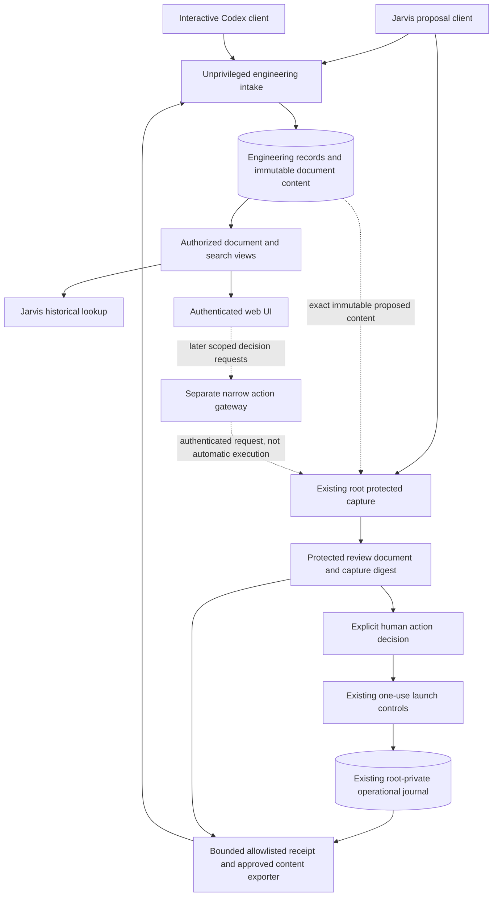

# Architecture decision D1: engineering history authority and storage

Status: **D1 separate-service direction accepted by the operator**, October22,2026.
Detailed implementation design remains subject to source review. No live paths or
owners change. This document distinguishes operational authorization from engineering
knowledge, even if they are displayed in one timeline.

## Options

| Option | Benefits | Costs / boundary |
| --- | --- | --- |
| A. Extend the root journal with a narrow privileged intake broker | One existing durable store and event chain; private evidence stays colocated. | Every ordinary note/import crosses a new privileged interface; web/session input reaches a root writer. Schema/capacity/publication evolution becomes coupled to protected runtime upgrades. Browser still cannot open the database. |
| B. Dedicated unprivileged engineering-history service linked to the root journal — selected direction | Interactive intake, curated documents/search/web can evolve without exposing operational control/private logs. Existing protected journal is preserved. | New service/store/account; two distinct authorities need explicit ID/receipt links, idempotent export/import, freshness and backup rules. No cross-store transaction is implied. |
| C. Markdown/Git only | Familiar browsing and diffing, fewer server components initially. | Weak structured queries, approval concurrency and private access separation; poor foundation for web controls unless an additional authority service is later introduced. |

The operator selected B. It is a new architectural component, not an already
approved deployment. The initial design uses SQLite for one local history writer; PostgreSQL remains an alternative
if concurrent deployment/operational requirements justify it. Do not activate the
stopped activity ledger or share its grants/schema as an implementation shortcut.
Do not claim DBeaver direct database access before access/replica policy is designed.

## Recommended component relationships

The diagram is a proposal. Solid arrows describe content flow, not implicit trust.
The future gateway must use the existing action-specific controls; it is not a root
shell/API. A browser acceptance of an interactive deliverable is not a paid launch
approval. A model/tool invocation is not an authenticated human decision.

## Authorities and identities

- Root operational records remain authoritative for protected capture/approval,
  launch consumption, stop and validation observations. Current journal path stays.
- Engineering records are authoritative for accepted curated intent/rationale,
  session/checkpoint content, document versions and evidence associations. A model
  may submit a draft, not declare human acceptance or observed root execution.
- Git/GitHub remain the evidence sources for actual source changes/remote PR facts.
  An imported receipt is not independent remote attestation; verification is an
  additional dated fact with identity/digest and stale/unknown handling.
- One stable engineering work ID links contexts. Operational wrk IDs can be reused
  for existing work with explicit namespace/import mapping; collisions never merge
  by title/path similarity. Cross-repository efforts group separate work items.

## Proposed persistence, atomicity and delivery

New account/service and exact paths are installation decisions, not created here.
Proposed service-owned0700 data root contains the engineering SQLite database,
content-addressed immutable approved document/evidence objects, and rebuildable
projections/search indexes. No provider keys or raw transcripts in this store.

One transaction commits record metadata, object bytes or confirmed durable object
references, an ingest receipt and outbox entries. For small approved Markdown, prefer
storing bytes transactionally in SQLite initially, avoiding a filesystem/DB dual
write. Larger detached objects require fsync-before-reference, digest verification,
orphan recovery and no success receipt until durability is established. Snapshot
publishing atomically changes a generation pointer only after all files are durable.

Root export and engineering import are asynchronous, bounded and idempotent by
source event/artifact digest. Engineering intake never opens the root database.
No automatic private-log export: only policy-reviewed fields/content and receipt
identities. Detailed safe operational facts need a new explicit projection/export
contract; the current sanitized view omits most references. An outage leaves pending
export/import state and visible lag; it must never retry coding or lose consumed
approval state. Failed telemetry does not retroactively invalidate work already done.
Managed execution's protected journal-before-launch requirements remain unchanged.

Interactive clients buffer bounded approved summaries in their private local spool
when intake is unavailable. They show 'not recorded' until a server receipt arrives.
Hook delivery is at least once or missing, never assumed exactly once. Client event
keys support deduplication; conflicting same-key bytes refuse. Concurrent checkpoints
use expected revision/head; scope changes require rebase/review, not last-writer-wins.

## Documents, corrections and disclosure

Canonical structured content plus a pinned template/renderer version generates exact
UTF-8 Markdown bytes. Store the bytes and digest once; a later renderer creates a new
document version. Root-captured review bytes never change with a UI theme, mutable
latest link or template edit. Signed-in viewers receive only authorized versions.

Corrections/supersession append. Confidentiality withdrawal can hide content from
shared views and remove it from indexes without rewriting protected approvals.
Sensitive payload removal/retention law needs separate policy; append-only metadata
is not a mandate to keep leaked secrets available forever. Avoid storing secrets
initially, and never treat redaction as erasing Git/external copies.

## Backup, restore and retention

Before live use: consistent SQLite backup plus referenced immutable objects,
configuration/schema/renderer versions, grants and digest manifests; encrypt any
backup containing private material. Test restoration into an isolated instance with
all action execution disabled. Reconcile durable source receipts after the restore;
never replay execution approvals/actions. Search/projections rebuild from records.
Operational and engineering stores have separate backup heads and explicit import
checkpoints; no pretend cross-store atomic snapshot. Off-host target, retention and
RPO/RTO need operator selection before production retention is promised.

## Rollout and reversibility

Keep v1 root records/readers working. Ship new engineering schemas/interfaces under
new versioned envelopes, with additive explicit adapters. Do not mutate old approval
records, reuse old one-use grants or silently migrate a live SQLite store. Begin with
synthetic fixtures, then explicit retrospective import, then current interactive work,
then protected capture integration. Read-only web follows; action gateway last.
Disabling engineering intake leaves operational controls intact and exposes missing
history delivery. Stopping a client must not trigger a paid run or shared-store loss.
