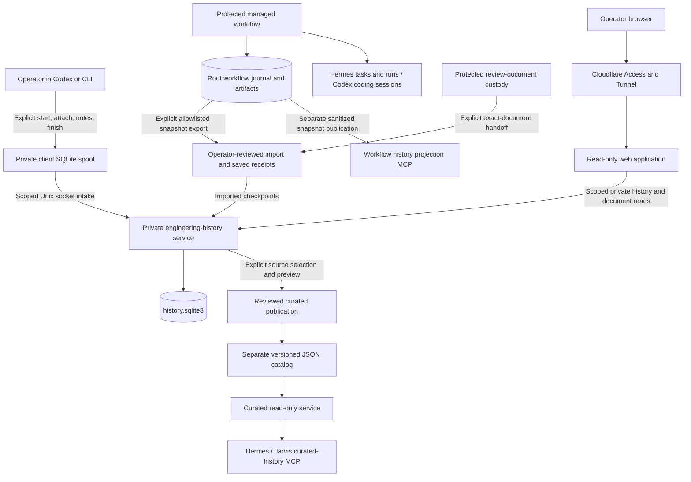
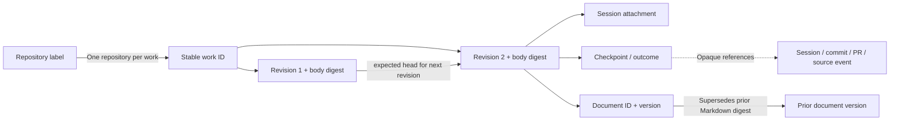

# Jarvis engineering history: architecture, collected data, relationships, and webpage

Reviewed November 5, 2026 · Prepared for the data-model and webpage customization discussion.

## 1. Start here

The existing system preserves **explicit engineering records**: what a work item is intended to accomplish, why it matters, selected session associations, progress and handoff notes, reported outcomes, retained Markdown documents, and selected evidence imported from managed execution.

It does **not automatically record every Codex or Jarvis conversation**, inspect every Git change, or keep every work item's GitHub and deployment status current. Its completeness depends on explicit recording and imports.

There are three main history layers, each serving a different audience:

1. **Protected workflow journal:** detailed records and artifacts associated with managed engineering execution and operator decisions.
2. **Private engineering history:** the operator's broader record of intent, continuity, documents, and imported evidence. **This is the database behind the webpage.**
3. **Curated catalog:** deliberately selected summaries that Jarvis can search and read. This is a separate publication, with a narrower scope than the webpage.

The data model is strong at keeping one work item's revisions and evidence together. It has limited support for organizing multiple work items into a larger effort or querying detailed results consistently across work. Some useful detail exists only as document text or embedded imported JSON.

For your two decisions, the most useful sections are:

- **Sections 4–6:** exactly what the history database can contain, how it is physically stored, and how records relate.
- **Sections 7–9:** which managed data reaches it, what Jarvis receives, and what the webpage currently exposes.
- **Sections 10–11:** limitations and a worksheet for deciding what you want.

## 2. Scope and evidence for this review

### Verified source baseline

- Repository: [shanereviello/jarvis](https://github.com/shanereviello/jarvis).
- Reviewed local checkout: `/home/shanereviello/Documents/Codex/2026-10-17/files-mentioned-by-the-user-rras/work/jarvis-migration-source`.
- Local branch: `codex/history-dashboard-closeout-20261104`; clean when inspected.
- Local source commit: `40d739949ac6f4194e0ccf0fe96dcfd75f624d51`.
- GitHub `main` comparison: one merge commit ahead, zero behind, **no file differences**. PR #88 merge commit is `87fb60b1f13003daf90ad94cbed6d96053d04ec6`. Thus the reviewed files match the merged baseline even though that merge object is absent locally. [S1]

I reviewed the implementation, JSON contracts, database definitions, representative tests, repository development history, operator runbook, implementation status, closeout, and your remaining-work handoff. Older documents often describe a component as source-only or installation-pending because they were written during its development. Current status and the handoff take precedence when describing reported deployment.

**Evidence boundary:** this is an architecture and supported-data review. I did not query the production history database, enumerate current private work items, inspect production credentials/configuration, or repeat live browser acceptance. Consequently, “supported field” means the implementation can store it; it does not establish that every existing record contains meaningful content in that field. Deployment observations below are attributed to the handoff and repository status, rather than newly verified live state.

The three embedded SQLite schemas were also executed in disposable in-memory databases to verify the table/column descriptions in this guide. No application or production data was changed.

## 3. System architecture



### Responsibilities and storage boundaries

| Component | What it owns | Storage / access |
| --- | --- | --- |
| Hermes / native tooling | Native managed tasks, runs, worktrees and worker lifecycle | Native state; selected identities and observations can be referenced in workflow evidence. The webpage does not directly query it. |
| Codex App Server | Managed coding session and workspace sandbox | Session contents are separate from this history database. |
| Protected RRAS workflow | Admission, exact reviews/approvals, execution boundary, validation and publication evidence | Root-private control state, artifacts and workflow journal. |
| Workflow journal | Managed work/repository snapshots, attempts, events and artifact bytes | `/var/lib/rras-workflow/journal/workflow.sqlite3`. |
| Interactive history client | Explicit association with a work revision and reliable delivery | Operator-selected private state directory containing `client.sqlite3`. |
| Engineering-history service | Private immutable submissions, receipts and retained Markdown | `/var/lib/rras-engineering-history/history.sqlite3`; service UID 995; reads/writes through `/run/rras-engineering-history/service.sock`. |
| History web application | Authenticated, read-only presentation | Dashboard UID 993, reported read access to repository `jarvis`; no direct SQLite connection. Reported release: `/opt/rras-engineering/releases/history-web-9e150671dcfa`. |
| Curated catalog | Exact versions of summaries deliberately shared with Jarvis | Versioned JSON files under `/var/lib/rras-curated-history/catalog`; separate service/read principal. |
| Legacy activity ledger | Older PostgreSQL task/run/event and execution compatibility data | Separate `activity` schema. It does not back this webpage. Current history outboxes do not deliver to it. |

The curated service runs as UID 995 in a restricted process with the private history paths hidden. Its container-facing client uses UID 994. Sharing the service account number does not make the curated API a private-history API. [S2][S3][S4]

### How this architecture developed

Repository history shows the layers were built in sequence:

| Development milestone | Relevant merged PRs |
| --- | --- |
| Shared workflow contracts, durable journal and managed event adapters | #15, #18–19 |
| Finish/publication evidence, native observations, validation and managed acceptance | #23–40 |
| Engineering-history design, private store, explicit client and Unix service | #41–50 |
| Managed export/sync and exact protected review-document retention | #51–66 |
| Curated sharing and restricted Jarvis retrieval | #67–79 |
| Read-only webpage, protected packaging, activation and closeout | #80–88 |

This explains why similarly named records and readers exist in several places: the workflow journal predates the broader private engineering history, and curated retrieval is a separate sharing layer. They are not interchangeable database interfaces.

## 4. Exactly what private engineering history records

The accepted contract is `engineering-history.v1`. There are **six intake operations**, with strict field sets. Arbitrary new fields are refused until the contract and implementation are deliberately extended. [S5]

### Common envelope on every submission

| Field | Meaning |
| --- | --- |
| `contract` | Protocol identifier, `engineering-history.v1`. |
| `operation` | One of the six operations below. |
| `client_event_key` | Stable retry identity for the same exact submitted input. |
| `expected_head` | Expected current work-definition SHA-256; null for first creation. Helps reject stale writes. |
| `source.kind` | `agent_reported`, `human_reported`, or `imported`. The private history contract has no `observed` option. |
| `source.namespace` | Producer/context label, such as `codex_interactive` or `managed_workflow_export`. |
| `source.id` | Reported source identity or null when unknown. |
| `occurred_at` | Claimed source occurrence time in UTC, or null. Separate from the service's receipt time. |
| `body` | Operation-specific content. |

A source labeled `human_reported` is still reported provenance. The service authenticates the local OS caller; the label does not independently authenticate the person or the described action.

### A. Work creation and revision: `work.create`, `work.revise`

Both store a **complete work definition**, rather than a patch:

| Field | Meaning / current shape |
| --- | --- |
| `work_item_id` | Stable `wrk_` identity, maintained across revisions. |
| `revision` | Positive integer; starts at 1 and advances by exactly 1. |
| `repository_id` | One repository label. Cannot change for an existing work ID. |
| `title` | Single-line title, up to 200 characters. |
| `objective` | Intended result, up to 16,384 characters. |
| `rationale` | Why the work matters, up to 16,384 characters. |
| `acceptance_criteria` | 1–64 objects, each with a unique stable `id` and a `description`. No result/status/evidence fields on the criterion itself. |
| `allowed_paths` | Up to 128 distinct canonical relative paths. Recorded scope, not a runtime access grant. |
| `baseline` | `{ref, commit}` or null. Captured starting point; does not track subsequent Git changes. |

There is no dedicated owner, priority, tags, initiative, due date, dependency list, work mode, target branch, resulting commit, or lifecycle status in this private work-definition contract. Some of those concepts exist elsewhere or can be written in narrative fields; they are not equivalent to first-class work attributes.

### B. Session association: `session.attach`

Stores `work_item_id`, `work_revision_sha256`, `client_namespace`, and nullable `session_id`.

This says a reported session/context is associated with an exact work revision. It does not capture the chat transcript, authenticate a native Codex session identity, or create a normalized session entity. The installed client defaults generated records to the `codex_interactive` namespace. A missing native session ID remains null. [S6]

### C. Progress and handoff: `checkpoint.append`

Stores:

- `work_item_id`, `work_revision_sha256`.
- `checkpoint_type`: `progress`, `pause`, `handoff`, or `interruption`.
- `summary`: up to 16,384 characters.
- `decisions`: up to 32 text strings.
- `next_action`: text or null.
- `references`: up to 32 namespaced references.

The `decisions` array contains text. It has no separately structured decision ID, target, actor, result or decision timestamp. Managed journal decision events are richer, but arrive through a different representation described in Section 7.

### D. Reported result: `outcome.record`

Stores `work_item_id`, `work_revision_sha256`, `outcome`, `summary`, and `references`.

The **actual allowed outcome values** are:

```text
completed_claim | partial | failed | unfinished | uncertain
```

Recording an outcome does not freeze the work, forbid later notes, verify every criterion, or establish acceptance, merge, deployment or operational verification. Multiple outcome records can exist.

### E. Retained Markdown: `document.render`

Stores:

- Work ID and exact work-revision digest.
- `document_id`, `document_version`, `document_type`.
- Type: `review`, `checkpoint`, or `completion`.
- `supersedes_document_sha256`: prior Markdown digest, or null for the first version.
- `fields`: the exact text fields required by the selected template.
- `references`.

The service renders and stores exact Markdown bytes and a companion manifest. The manifest contains document/work identity, version/type, Markdown SHA-256, content SHA-256, template SHA-256, renderer SHA-256, private visibility and `draft_not_approval` status. Old document bytes are retrieved as stored, even if the renderer later changes. [S7]

The templates can preserve much richer narrative than the small work/checkpoint schemas: alternatives, dependencies, risks, constraints, source changes, validation mapping, per-criterion result tables, limitations, lessons and follow-ups. **These are text fields and Markdown tables; they are not automatically structured database entities or required content on every work item.** Unknown values may remain explicitly unknown. A retained review document is not itself an execution approval.

### Shared references

Checkpoint, outcome and document references have:

```text
namespace: session | git_commit | pull_request | external | operational_event | document
id: opaque string
sha256: exact digest or null
```

References preserve pointers and optional content identity. Most are not resolved, fetched, checked for current validity, or enforced as foreign keys. A `document` reference string is weaker than the explicit document-to-work binding enforced during storage.

## 5. How this is physically stored

### Private history database: two tables

The database is **an append-only submission log with JSON payloads**, rather than separate SQL `works`, `sessions`, `checkpoints`, and `documents` tables. Application code validates and reconstructs those concepts. [S8]

`submissions`:

| SQL column | Type | Content |
| --- | --- | --- |
| `sequence` | INTEGER PRIMARY KEY | Global service-store insertion order, across work items. |
| `principal` | INTEGER NOT NULL | OS-owner identity for local mode; negative authenticated peer UID for service mode. An internal idempotency namespace. |
| `operation` | TEXT NOT NULL | Intake operation. |
| `client_key` | TEXT NOT NULL | Submitted `client_event_key`. |
| `request` | BLOB NOT NULL | Canonical UTF-8 JSON envelope and body. |
| `request_sha256` | TEXT NOT NULL | Hash of those exact request bytes. |
| `receipt` | BLOB NOT NULL | Canonical JSON receipt. |
| `document` | BLOB, nullable | Exact Markdown bytes for a rendered document. |
| `manifest` | BLOB, nullable | Canonical JSON document manifest. |

Uniqueness: `(principal, operation, client_key)`. Identical retry returns the original receipt; changed bytes under the same key are refused. SQL triggers refuse updates and deletes.

`outbox`:

| SQL column | Type | Content |
| --- | --- | --- |
| `sequence` | INTEGER PRIMARY KEY / foreign key | Associated submission. |
| `request_sha256` | TEXT NOT NULL | Pending record digest. |

Each submission and its outbox row commit together. Outbox mutation/removal is refused in this version; external index delivery is **not implemented**. An outbox entry does not mean the record was sent to PostgreSQL or Jarvis.

### Receipt: what is known about ingestion

A receipt includes `receipt_id`, global `sequence`, `request_sha256`, work ID, work-revision digest, service `recorded_at`, `writer_uid`, transport, provenance, private visibility, `authority_granted=false`, and optional document manifest.

Authenticated service receipts use `engineering-history-receipt.v2` and additionally include `peer_uid`. Direct caller-owned store receipts use v1. This distinguishes the process storing the record from the local process that submitted it; it does not prove that the narrative inside is true.

### Durability and limits

- Private directory mode 0700 and database mode 0600; deployed service owns the canonical store.
- SQLite rollback journaling with `synchronous=FULL` and serialized write transactions.
- Work-head comparison, request/Markdown digest checks, and atomic receipt/outbox persistence.
- Current implementation bound: **10,000 total submissions per store**.
- Requests: at most 128 KiB; retained Markdown: at most 256 KiB.
- No semantic/full-text index, embeddings, reporting tables, or database-backed work relationship graph in this store.

This protects consistency and replay under the tested boundaries. It is not a signed audit log or proof against replacement by the database owner. Combined backup/restore verification remains deferred in the handoff.

### Client spool: a separate database

Each explicit client state has `client.sqlite3` with four tables:

| Table | Purpose |
| --- | --- |
| `configuration` | Fixed transport, service identity and client identity. |
| `context` | Active work ID, revision digest and nullable session identity. |
| `actions` | Stable action key, input digest and saved input. |
| `queue` | Ordered requests, saved receipts, delivery errors and abandonment dispositions. |

This supports offline queueing, restart, retry and lost-response recovery. A request may have committed on the service before the client receives its receipt. Resuming the original request recovers the original receipt; it does not repeat coding work. Pending client-state details are not presented by the current webpage. [S6]

## 6. Relationships: what is enforced and what is merely referenced



Solid links represent explicit application bindings. Dashed references are generally pointers, not resolved relational joins.

| Relationship | Current guarantee | Limitation for your review |
| --- | --- | --- |
| Repository → work | One immutable repository association per work ID. | Private history has a repository label, not a registration table containing current remote/branch/settings. |
| Work → revisions | Stable ID, sequential revision number, exact current-head comparison on append. | Revision relationships are reconstructed from submissions; no independent revision table or revision-diff webpage. |
| Revision → note/outcome/session/document | New submissions must target the exact current work-definition digest. | Late notes targeting an older scope are refused. Historical existing records remain attached to their original scope. |
| Session → work | Explicit attachments; client-generated notes also carry reported source session identity. | No normalized session lifecycle or mandatory checkpoint-to-attachment foreign key. Unknown sessions cannot reliably be separated by native identity. |
| Work → document versions | Stable document ID; sequential versions; same work/type; superseding Markdown digest must match. | No arbitrary file-attachment model or automatic collection of generated files. |
| Note → evidence | Namespaced pointer and optional hash. | Most targets are not fetched or existence-checked. |
| Managed work → private work | Import checks matching work ID, repository, baseline and paths, and saves both revision identities/digests. | Operational and engineering revision numbers are separate. Imported metadata is largely embedded text. |
| Source record → curated entry | Exact source request hash and receipt ID retained. | Publication does not synchronize later source changes. |
| Work → another work / initiative | Narrative or generic external references are possible. | No typed `parent`, `depends_on`, `blocks`, `related_to`, or cross-repository initiative entity. |
| Criterion → validation result | Can be explained in document text and source artifacts. | No structured private-history criterion-result relationship or automatically computed coverage. |

The private submission log should not be confused with the managed journal's per-work hash-linked event chain. Private records have hashes and global sequence numbers, but no `previous_event_sha256` field forming that same chain.

## 7. Managed workflow: richer source data and what reaches the webpage

### Root journal data model

The protected journal stores four record kinds using the separate `workflow-v1` contract: [S9]

| Kind | Important fields and relationships |
| --- | --- |
| Repository registration | Registration ID/revision, repository ID, canonical path/remote/object format, allowed/denied roots, baseline refs, validation recipes, review-branch publication policy, actor and provenance. |
| Work item | Work ID/revision, previous snapshot digest, exact registration digest, mode, objective, requested paths, optional baseline and validation-recipe ID, actor/provenance and references. |
| Attempt | Attempt ID/number, exact work and registration digests, repository, mode, executor, baseline, optional authorization/delegation references, actor/provenance and references. |
| Event | Event ID, per-work sequence, previous event hash, exact work digest, optional attempt ID, event type/outcome, source and recorded times, actor/provenance, summary, artifacts, references, optional correction target and decision subject. |

Modes are `interactive`, `approval_driven`, and `delegated`; schema support for a mode does not imply deployed automatic delegation. Artifacts have ID, digest, media type, purpose and visibility; the journal can retain their exact bytes.

Event types distinguish preparation, review, execution approval, attempt start/interruption/finish, validation, artifact recording, branch publication, PR opening, merge, deployment, verification, cancellation, recovery and decisions. Decision subjects include scope change, deliverable acceptance, merge, deployment and other.

The journal physically uses:

```text
meta(version)
records(digest, kind, identity, revision, body,
        ingest_kind, received_at, writer_uid)
artifacts(digest, body)
outbox(record_digest)
```

Record bodies are canonical JSON; artifact bodies are bytes. Record identity/revision uniqueness and application validation enforce snapshot/attempt/event relationships, including correction targets. This is a richer execution-evidence model than the private work-definition schema, although it also uses JSON bodies. Protected workflow receipt files and native task/session state are additional stores, not columns in this journal. [S10]

### Exactly what the managed event export includes

The exporter reads a frozen, read-only snapshot for one **exact operational work revision**. It exports:

- Journal identity and work ID/repository/revision/mode, baseline, requested paths and source work-record hash.
- For each selected event: event ID, sequence, event type, outcome, source occurrence/recorded times, optional attempt ID, optional correction target, optional decision subject, source-record hash, original provenance and ingestion kind.
- Artifact **IDs, digests and purposes**, including metadata for private artifacts; artifact bytes are excluded.
- Allowlisted commit IDs and PR URLs, with an omitted-reference count.
- Pagination cursor and whether more source events remain.

It excludes source objectives, free-text event summaries, actor/configuration payloads, full native/session/authorization references, prompts, logs and artifact bodies. Thus a missing detailed explanation in the webpage may be absent from the import even when it exists in the protected journal. Review documents use the separate exact-document handoff to preserve richer selected content. [S11]

### How imported events are represented in private history

Each event becomes a **`checkpoint.append` / `progress`** record with `source.kind=imported` and namespace `managed_workflow_export`.

Its `summary` contains a warning line followed by JSON:

```text
Imported operational source claim; original provenance is quoted, not authenticated by this intake.
{"binding": {...}, "source_fact": {...}}
```

`binding` retains journal/work identity, operational revision/hash and engineering revision/hash. `source_fact` retains the allowlisted event metadata above. References include the operational event ID/hash, a workflow source pointer and selected public references. The outer checkpoint has `occurred_at=null`, `decisions=[]`, and `next_action=null`; source timestamps/decision subject remain inside the embedded JSON. [S12]

Consequences for a customized UI:

- Source merge/deployment/validation events are available as imported evidence **if explicitly exported and imported**, but are not native top-level private event types.
- An imported successful `attempt.finished` does not create a private `outcome.record` automatically.
- A source correction relationship survives in embedded JSON; the current webpage does not resolve it into a corrected lifecycle view.
- Source event time and history import time differ. Sorting by import receipt time answers “when was this recorded here,” not necessarily “when did the engineering action happen.”
- Current sync completion/cursor state is saved in separate receiver files. The webpage does not establish that all events through the present have been imported.

### Older workflow projection reader

The workflow system also has a separate sanitized snapshot reader, exposing `workflow_pages` and `workflow_history`. It reads deliberately published JSON projections, not the private journal or the engineering-history database. It preserves bounded stage/event metadata but excludes private narrative and artifact bytes. This earlier reader and the newer curated-history MCP can coexist; the webpage uses neither as its data source. [S13]

## 8. What Jarvis receives

The curated catalog consists of a configuration file, immutable generation files, and an atomically replaced current-generation pointer. It is **not a third SQL database**. Publication binds an exact reviewed preview and expected generation; withdrawal creates a new view and stale generation cursors are refused. [S14]

Each curated entry contains:

- Entry ID, repository ID and work ID.
- Deliberately written `summary`, `rationale`, and `limitations`.
- Source operation, source provenance, source request digest and receipt ID.
- Source recorded and nullable occurrence times.
- Curation provenance, `source_authenticated=false`, and `release_status=not_inferred`.

The deployed curated MCP exposes `engineering_history_search` and `engineering_history_read`. The recorded deployment published **three selected summaries**: foundation design intent, managed documentation-task intent, and the imported PR #38 merge claim. The status reports no private document bodies in those entries. This is a reported published set, not a new live catalog census. [S3]

Private recording, managed sync, older workflow projection publication, and curated publication are distinct operations. Editing the webpage's presentation will not automatically broaden Jarvis retrieval.

## 9. How the current webpage selects and displays data

The browser uses static HTML/CSS/JavaScript. A Python Starlette application authenticates the configured operator using Cloudflare Access JWT verification and presents read-only routes. The backend uses the authorized Unix history/document API; it never opens SQLite directly. [S15][S16]

```text
GET /api/repositories
GET /api/works?repository_id=...&q=...&offset=...&limit=...
GET /api/works/{work_id}?repository_id=...
GET /api/documents/{document_id}?repository_id=...&work_id=...&version=...
```

| UI area | Current selection and presentation |
| --- | --- |
| Repository selector | Explicit configured repository grants. Reported production grant is `jarvis`. |
| Work list | Latest work definition, title, revision, latest reported outcome and last receipt time. Sorted by last recorded time, newest first. |
| Search | All query terms must match title/objective/rationale, case-insensitively. Does not search checkpoint text, retained document bodies or all evidence. |
| Overview | Latest objective, rationale, criterion descriptions, allowed paths, baseline and work ID. Criterion IDs are stored but not displayed here. |
| Timeline | All operations for the work, newest insertion first; generic operation label, summary, provenance, decisions, next action, optional session/outcome and recorded/occurred times. Long summaries expand as text. |
| Documents | Every retained document/version associated with the work. Open verifies exact Markdown and shows source text; download preserves it. |
| Evidence | Deduplicated supported `https://github.com/...` links from references, including supported embedded imported references. Bare commit hashes, private artifact digests and other namespaces do not become navigable evidence here. |
| Footer | Time the browser read history. Does not show source export freshness or last successful managed sync. |

The reader returns some data the browser does not visibly present, such as timeline receipt IDs/sequences and work record counts. Other stored fields are omitted from the reader's projection, such as full source namespaces/IDs, generic reference arrays, checkpoint type and each timeline record's exact work-revision binding. These differences matter: some changes need only frontend work; others need a broader read projection even though storage already contains the data. [S15][S17]

### Current implementation details that affect interpretation

1. **Outcome labels are incomplete.** The schema accepts `completed_claim`, `partial`, `failed`, `unfinished`, and `uncertain`. The frontend has a specific label for `completed_claim`, but also labels `failed_claim`, `blocked_claim`, and `cancelled_claim`, which this schema does not accept. Valid non-completion outcomes fall back to the generic “Outcome reported.” This is a source-level presentation mismatch, not a newly observed production incident.
2. **Latest outcome spans the work's history.** The current projection can show an outcome from revision 1 beside the definition of revision 2. It does not restrict the badge to outcomes bound to the current scope.
3. **Imported lifecycle events look like checkpoints.** The current timeline does not give an imported merge or validation event its own structured stage view; it largely shows the warning and embedded JSON as note text.
4. **Reads scan repository history.** List/detail construction repeatedly obtains the repository's records and computes views in Python. Current bounds include 10,000 records, 8 MiB of retrieved rows and a 15-second aggregation deadline; list pages are at most 50 works. These are bounded reads, not demonstrated large-history performance.
5. **A read is not a frozen multi-request audit snapshot.** The backend fetches separate pages without a shared snapshot token, and list/detail/document requests occur separately. Concurrent appends may advance the data between reads.
6. **Configuration is deployment-level.** There is no saved user layout, configurable column set, dashboard builder or saved filter model. Repository access and operator identity come from protected configuration; presentation choices are currently code.

The webpage has no create/edit/approve/merge/deploy routes. Responses request private/no-store caching, and the frontend clears private state on read errors, sign-out and page lifecycle events. The handoff still leaves evidence-link destination and refresh-after-sign-out behavior unverified in the real browser; source controls alone do not complete those checks.

## 10. What the current model can answer—and where information is missing

“Missing” has several meanings. The distinction below should prevent unnecessary database work.

| Question you may want answered | Current data position | Likely change category if you want it |
| --- | --- | --- |
| What was requested, why, against what scope? | Structured work fields already exist. | UI arrangement and capture quality. |
| What happened across checkpoints and handoffs? | Explicit notes exist when recorded. | UI grouping/search; recording discipline or additional capture coverage. |
| Which scope revision does this note or result describe? | Exact binding stored; current timeline presentation drops it. | Read projection and UI. |
| What changed between scope revisions? | Complete prior definitions stored. | Revision comparison projection/UI. |
| What happened during managed execution? | Rich source metadata exists; only reviewed exported snapshots arrive here. | Typed import projection/UI plus freshness/coverage design. |
| What is the current native task/run/session status? | Not a live webpage data source; identities only partially retained through imports. | New scoped integration and explicit freshness semantics. |
| Which criteria passed, failed, or remain unverified? | Criteria are structured; results may be narrative/documents/artifacts. | Structured result/evidence model if consistent filtering or computation is wanted. |
| Which work items belong to this larger initiative? | No first-class initiative or membership relationship. | Model and intake extension, then UI. |
| What blocks what, including across repositories? | Narrative references only. | Typed relationships and policy, then UI. |
| Who owns this work, what is its priority and status? | No dedicated private work attributes for these. | Model/capture extension or agreed derivation rules. |
| What commit/PR/release resulted, and was it verified? | References/imported stage facts may exist; no automatic current GitHub/release reconciliation. | Provenance-aware projection; new integration if current external verification is required. |
| How much time, token usage or money did this effort consume? | No dedicated private history metrics; current exports do not include them. | New collection source, definitions and model. Cannot infer from note timestamps. |
| Can I search everything I recorded? | Current list search covers intent fields only. | Scoped search/index/read changes. No storage engine migration inherently required. |
| Is the record complete and current? | Receipt times exist; receiver cursor/coverage state is separate; recording remains explicit. | Coverage/freshness model and presentation, with collection decisions if desired. |
| Can Jarvis read everything visible to me? | Current curated access is narrower. | Separate retrieval/sharing scope decision. |

Other model gaps to consider: structured decision rationale/subjects for interactive work, first-class change/file links, machine-queryable lessons, corrected/superseded non-document notes, and explicit relationships among review, acceptance, merge and deployment evidence. The root journal already handles some of these more precisely; private-history expansion should preserve that provenance instead of treating imported claims as independent observations.

**Assessment:** the foundation is sufficient for explicit per-work history and exact document retention. For an initiative-oriented engineering workspace with consistent status, dependency navigation, criterion coverage and release evidence, several desired views will require additional relationships or structured projections. SQLite itself is not the missing capability.

## 11. Worksheet for your requirements discussion

These are decisions to make, not an approved implementation plan.

### A. What should an engineering work item mean?

- [ ] One chat, one requested change, one PR, or one scope that can span chats and PRs?
- [ ] Should a larger initiative contain work from multiple repositories?
- [ ] Which relationships matter: parent/child, related work, dependencies, blockers, follow-ups?
- [ ] Which fields should be mandatory: owner, priority, tags, category, milestone, target release?
- [ ] Should an outcome for an old scope remain visible separately from the current revision's status?

### B. What evidence should be captured?

- [ ] Structured criterion results, test/check identities and evidence links?
- [ ] Source commits/PRs/changed paths with verification time?
- [ ] Separate observed validation, human acceptance, merge, deployment and runtime verification?
- [ ] Structured decisions, alternatives, rationale, risks, unknowns and lessons?
- [ ] Real session/attempt identities where reliably available?
- [ ] Capture-coverage and last-sync information so absent data is explainable?
- [ ] Time/cost metrics, with a trusted source and clear attribution rules?

### C. What should the webpage show first?

| Candidate view | What it would help you inspect |
| --- | --- |
| Initiative overview | Related work, progress, blockers and decisions across repositories. |
| Work table | Chosen columns and filters for status, ownership, scope, dates or evidence coverage. |
| Work detail | Intent, current scope, next action and evidence in your preferred order. |
| Revision comparison | How scope, rationale and criteria changed. |
| Structured timeline | Separate interactive notes and imported execution/validation/publication facts. |
| Criteria/evidence matrix | Requested result → checks → results → evidence → limitations. |
| Document library | Search and browse retained reviews/checkpoints/completions across work. |
| Release history | Distinct acceptance, merge, deployment and verification with provenance. |
| Capture-health view | Pending delivery, last managed sync and known coverage gaps. |

For each desired field/view, decide whether it is **already stored**, **present only in protected source data**, **present as narrative**, or **not collected**. Then decide how it should be captured, whether it is required, what “unknown” looks like, and who may read it. That gives us a concrete basis for both the data changes and your exact webpage layout.

## 12. Source map

Links below are pinned to the merged baseline. They are implementation references, not live database or deployment receipts.

| Ref | Source and purpose |
| --- | --- |
| S1 | [PR #88 merged baseline](https://github.com/shanereviello/jarvis/commit/87fb60b1f13003daf90ad94cbed6d96053d04ec6), [local-source-to-main comparison](https://github.com/shanereviello/jarvis/compare/40d739949ac6f4194e0ccf0fe96dcfd75f624d51...87fb60b1f13003daf90ad94cbed6d96053d04ec6). |
| S2 | [Engineering architecture](https://github.com/shanereviello/jarvis/blob/87fb60b1f13003daf90ad94cbed6d96053d04ec6/engineering/docs/architecture.md). |
| S3 | [History implementation status](https://github.com/shanereviello/jarvis/blob/87fb60b1f13003daf90ad94cbed6d96053d04ec6/engineering/docs/engineering-history-implementation-status.md), [dashboard closeout](https://github.com/shanereviello/jarvis/blob/87fb60b1f13003daf90ad94cbed6d96053d04ec6/engineering/docs/engineering-history-dashboard-closeout.md), [operator runbook](https://github.com/shanereviello/jarvis/blob/87fb60b1f13003daf90ad94cbed6d96053d04ec6/engineering/docs/engineering-history-operator-runbook.md). |
| S4 | [Legacy ledger boundary](https://github.com/shanereviello/jarvis/blob/87fb60b1f13003daf90ad94cbed6d96053d04ec6/activity-ledger/README.md), [curated service isolation](https://github.com/shanereviello/jarvis/blob/87fb60b1f13003daf90ad94cbed6d96053d04ec6/engineering/tools/rras_history/curated_service_plan.py). |
| S5 | [Exact private-history JSON contract](https://github.com/shanereviello/jarvis/blob/87fb60b1f13003daf90ad94cbed6d96053d04ec6/engineering/contracts/engineering-history-v1.schema.json), [validation and encoding](https://github.com/shanereviello/jarvis/blob/87fb60b1f13003daf90ad94cbed6d96053d04ec6/engineering/tools/rras_history/contract.py). |
| S6 | [Interactive client and spool](https://github.com/shanereviello/jarvis/blob/87fb60b1f13003daf90ad94cbed6d96053d04ec6/engineering/tools/rras_history/interactive.py). |
| S7 | [Document renderer/manifests](https://github.com/shanereviello/jarvis/blob/87fb60b1f13003daf90ad94cbed6d96053d04ec6/engineering/tools/rras_history/documents.py), [templates](https://github.com/shanereviello/jarvis/tree/87fb60b1f13003daf90ad94cbed6d96053d04ec6/engineering/docs/engineering-history-phase1/templates). |
| S8 | [Private database schema and write rules](https://github.com/shanereviello/jarvis/blob/87fb60b1f13003daf90ad94cbed6d96053d04ec6/engineering/tools/rras_history/store.py), [repository-scoped service access](https://github.com/shanereviello/jarvis/blob/87fb60b1f13003daf90ad94cbed6d96053d04ec6/engineering/tools/rras_history/access.py). |
| S9 | [Workflow JSON contract](https://github.com/shanereviello/jarvis/blob/87fb60b1f13003daf90ad94cbed6d96053d04ec6/engineering/contracts/workflow-v1.schema.json), [relationship validation](https://github.com/shanereviello/jarvis/blob/87fb60b1f13003daf90ad94cbed6d96053d04ec6/engineering/tools/rras_native/workflow_records.py). |
| S10 | [Workflow journal schema/storage](https://github.com/shanereviello/jarvis/blob/87fb60b1f13003daf90ad94cbed6d96053d04ec6/engineering/tools/rras_native/workflow_journal.py). |
| S11 | [Operational exporter](https://github.com/shanereviello/jarvis/blob/87fb60b1f13003daf90ad94cbed6d96053d04ec6/engineering/tools/rras_native/engineering_export.py), [exact export contract](https://github.com/shanereviello/jarvis/blob/87fb60b1f13003daf90ad94cbed6d96053d04ec6/engineering/contracts/engineering-managed-export-v1.schema.json). |
| S12 | [Imported checkpoint mapping](https://github.com/shanereviello/jarvis/blob/87fb60b1f13003daf90ad94cbed6d96053d04ec6/engineering/tools/rras_history/managed_link.py), [managed sync](https://github.com/shanereviello/jarvis/blob/87fb60b1f13003daf90ad94cbed6d96053d04ec6/engineering/tools/rras_history/managed_sync.py), [exact document intake](https://github.com/shanereviello/jarvis/blob/87fb60b1f13003daf90ad94cbed6d96053d04ec6/engineering/tools/rras_history/review_document_link.py). |
| S13 | [Earlier workflow projection reader](https://github.com/shanereviello/jarvis/blob/87fb60b1f13003daf90ad94cbed6d96053d04ec6/engineering/docs/managed-journal-and-reader.md). Read its historical pending language alongside current closeout. |
| S14 | [Curated entry shape](https://github.com/shanereviello/jarvis/blob/87fb60b1f13003daf90ad94cbed6d96053d04ec6/engineering/tools/rras_history/curated_preview.py), [generation/publication storage](https://github.com/shanereviello/jarvis/blob/87fb60b1f13003daf90ad94cbed6d96053d04ec6/engineering/tools/rras_history/curated_publication.py). |
| S15 | [Web history projection and limits](https://github.com/shanereviello/jarvis/blob/87fb60b1f13003daf90ad94cbed6d96053d04ec6/engineering/tools/rras_history_web/history.py). |
| S16 | [Web routes/read-only boundary](https://github.com/shanereviello/jarvis/blob/87fb60b1f13003daf90ad94cbed6d96053d04ec6/engineering/tools/rras_history_web/app.py), [JWT authentication](https://github.com/shanereviello/jarvis/blob/87fb60b1f13003daf90ad94cbed6d96053d04ec6/engineering/tools/rras_history_web/access.py). |
| S17 | [Current frontend](https://github.com/shanereviello/jarvis/blob/87fb60b1f13003daf90ad94cbed6d96053d04ec6/engineering/tools/rras_history_web/assets/app.js), [page layout](https://github.com/shanereviello/jarvis/blob/87fb60b1f13003daf90ad94cbed6d96053d04ec6/engineering/tools/rras_history_web/assets/index.html), [styling](https://github.com/shanereviello/jarvis/blob/87fb60b1f13003daf90ad94cbed6d96053d04ec6/engineering/tools/rras_history_web/assets/app.css). |
| S18 | Representative tests reviewed: [private storage/documents](https://github.com/shanereviello/jarvis/blob/87fb60b1f13003daf90ad94cbed6d96053d04ec6/engineering/tests/test_engineering_history_local.py), [managed imports](https://github.com/shanereviello/jarvis/blob/87fb60b1f13003daf90ad94cbed6d96053d04ec6/engineering/tests/test_history_managed_link.py), [web projection/authentication](https://github.com/shanereviello/jarvis/blob/87fb60b1f13003daf90ad94cbed6d96053d04ec6/engineering/tests/test_history_web.py). Tests were inspected for intent; the existing suites were not rerun for this documentation-only review. |

