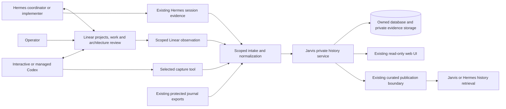

# Standardized History Reporting Format and Rules

Architecture document — **draft v0.2, for human review**  
Date: November 7, 2026, America/New_York  
Proposed repository: `jarvis`  
Purpose: durable engineering reference and debugging across interactive Codex and Hermes-coordinated work.

**Proposed direction:** use Linear to organize work, evaluate SpecStory and Entire for session capture, and retain the Jarvis-owned history database and web UI. Human review focuses on the governing architecture and material deviations. Routine implementation, reporting, and validation proceed within that agreement.

This is a new proposal for this project. It is separate from the already completed **Engineering History Workspace v0.2** effort. The [earlier reporting-rules draft v0.1](STANDARDIZED-HISTORY-REPORTING-FORMAT-AND-RULES-ARCHITECTURE-DRAFT-v0.1-20261106.md) remains unchanged. This revision replaces its proposed broad workflow-enforcement direction for review; it does not designate itself as governing.

Only research and this document were produced for this revision. No collectors were installed, Linear objects changed, history records created, production services inspected or modified, credentials read, or paid agent runs started. Product behavior below is documented behavior or source inspection, not an end-to-end compatibility test on the installed system.

## 1. Purpose and success criteria

The system should let the operator and Jarvis reconstruct engineering work after the original conversation has ended. It should preserve intent, alternatives, failed attempts, changes, validation, and operational outcomes, with enough source evidence to distinguish a reported conclusion from a verified result.

The two original problems remain central: recording did not start automatically when interactive work began, and several independently assessable deliverables were represented by one conversation-sized work item. Session capture addresses the first problem; explicit architecture work items and consistent Linear/Jarvis identity address the second.

Success means answering these questions with dated records and source references:

1. What problem was being solved, and what architecture did the human agree to?
2. What distinct work items were planned, and which actually happened?
3. Did Hermes coordinate, implement, or delegate the work? What did Codex do?
4. What was tried, what failed, and why was the final approach selected?
5. Which code, tests, review, merge, deployment, and runtime checks support the result?
6. What is unknown, missing from capture, deferred, or inconsistent with the plan?

The main deliverable is reliable engineering knowledge. A board status or a saved transcript alone is insufficient to establish completion.

## 2. Decisions carried into this proposal

| Area | Direction |
| --- | --- |
| Project architecture | Every project has a versioned architecture document, without exceptions. A human agrees to the governing version before implementation. The document contains the corresponding work breakdown. |
| Organization | Linear is the working project/issue interface. Reuse the operator's existing Hermes-to-Linear connection. |
| Agent alignment | Hermes and Codex share project/work identities and reporting semantics; their sessions, roles, attempts, and evidence remain distinguishable. |
| Capture | Evaluate SpecStory and Entire. Prefer an existing capture mechanism over building another general recorder. |
| Human oversight | Review the initial architecture and material architecture deviations. Do not require approval for every work item, checkpoint, command, test, or handoff. |
| History ownership | Keep the private Jarvis history service, database, retained documents, and developing read-only web UI. |
| Existing grouping | One repository/category per project; one primary project per assigned work item. `jarvis-non-git` remains the sole non-Git category. Baselines remain Git commits. |
| Exclusions | No n8n/Activepieces or other formal workflow engine, new autonomous scheduler, custom approval dashboard, or replacement coding runner. |

Existing execution, spending, repository, merge, and deployment permissions remain in force. Architecture agreement defines intended work; it does not grant new machine privileges or silently remove existing operational controls.

## 3. Research findings and capture recommendation

### 3.1 SpecStory and Entire

| Question | SpecStory | Entire CLI |
| --- | --- | --- |
| Documented approach | Exports native agent conversations to local Markdown. | Hooks connect agent sessions with Git checkpoints and commits. |
| Codex | Documented CLI integration reads existing session history and supports background watching. Actual desktop/remote layouts still require testing. | Codex is listed as supported. Actual desktop and managed-worker behavior still require testing. |
| Existing conversations | Explicit export of previously created Codex sessions is documented. | Do not assume arbitrary old-chat backfill; test the supported checkpoint/session recovery paths. |
| Storage | Markdown exports; custom output location is available. | Local metadata plus checkpoint Git storage and commit references. |
| Main fit | Capturing conversations, including research that produces no commit. | Tracing committed code back to agent evidence. |
| Main concern here | Export completeness and mapping across sessions/projects. | Hook compatibility and preventing unintended transcript publication to Git remotes. |
| Hermes | Native support was not established by the documentation reviewed. | Native support was not established by the documentation reviewed. |
| Cost boundary | Free, open-source CLI; hosted services are a separate choice. | MIT-licensed CLI; hosted forge/memory features are a separate choice. |

Sources: [SpecStory overview](https://docs.specstory.com/), [Codex integration](https://docs.specstory.com/integrations/codex-cli), [CLI reference](https://docs.specstory.com/integrations/terminal-coding-agents/usage), [Entire CLI](https://github.com/entireio/cli), and [Entire session/checkpoint architecture](https://github.com/entireio/cli/blob/main/docs/architecture/sessions-and-checkpoints.md).

**Provisional recommendation: evaluate SpecStory first as the primary Codex capture source, with Entire as the comparison candidate for stronger commit correlation.** Do not enable both by default. Select one after demonstrating the required coverage, or record that neither meets it.

This is an architectural preference, not a completed benchmark. Entire's support for commit-less snapshots means it must not be dismissed simply as commit-only; the test must establish what is retained automatically for research and interrupted sessions. Documentation and implementation evolve, so evaluation records must pin exact versions and settings.

### 3.2 Capture privacy and compatibility

SpecStory documents optional cloud synchronization and configurable analytics/telemetry. Entire documents checkpoint uploads to Git remotes and best-effort redaction. A separate Git ref is still publication of transcript content. [SpecStory privacy](https://docs.specstory.com/privacy), [SpecStory configuration](https://docs.specstory.com/integrations/terminal-coding-agents/usage), [Entire security](https://docs.entire.com/security).

The proposed evaluation therefore uses disposable repositories, synthetic transcripts, local output, no cloud account, disabled optional telemetry, and no transcript pushes. Verify those settings and actual behavior for the selected release before any real-history pilot. Never install hooks into the production checkout as part of research.

Native session files stay under their existing agent owner. Export only the selected engineering sessions. Collectors do not need provider credentials, another agent's authentication files, or privileged workflow journals. Redaction reduces exposure but does not prove that arbitrary transcript content is safe to publish.

### 3.3 Hermes evidence

Current Hermes documentation describes native session persistence, search, and stored tool interactions. These are useful existing sources; their current upstream layout is not proof of what this installation runs. [Hermes sessions](https://hermes-agent.nousresearch.com/docs/user-guide/sessions), [session storage](https://hermes-agent.nousresearch.com/docs/developer-guide/session-storage).

Inspect the installed version and supported read/export surface during implementation. Prefer an existing supported export or a small read-only normalizer over changing Hermes internals. For Hermes-coordinated Codex work, capture the coordinator session and the worker evidence separately. Existing managed journal/export records remain the source of protected execution facts.

If complete Hermes session capture requires a substantial new recorder, do not expand this project silently. Deliver the agreed structured reporting and existing managed evidence, display the capture gap, and bring that additional scope back for architectural review. Enabling unattended Hermes execution remains outside this project.

### 3.4 Capture selection test

Run both candidates against the same model-free fixtures and expected results. Use a separately authorized real-session pilot only after fixture success.

| Required case | Evidence to retain |
| --- | --- |
| Existing and newly created Codex session | Expected exchanges, identities, timestamps, and export contents; no manual request to record each turn. |
| Desktop/CLI and remote-workspace layouts actually used | Exact supported paths/formats and an explicit pass, failure, or unsupported result for each surface. |
| Research without edits or commit; interruption before finish | Recoverable source evidence and honest partial/final status. |
| Resume, compaction, compression, or source rotation | Preserved lineage, missing ranges if any, and repeatable restart behavior. |
| Two projects sharing one repository; a work switch in one chat | Explicit work associations; no assignment based solely on repository or time proximity. |
| Managed worker leaves changes uncommitted | Evidence survives worker cleanup and links to later publisher/validation records. |
| Handoff from Hermes to Codex | Distinct coordinator/worker identities connected to one work item. |
| Repeated export or lost intake response | No duplicate sessions, work items, or history events. |
| Privacy and hook coexistence | No unexpected upload, source change, damaged existing hook, or credential capture. |
| Export portability and resource use | Independent local readback, practical storage/CPU behavior, pinned configuration, and uninstall/recovery notes. |

Mandatory selection conditions are coverage of the actual work surfaces, private export, recoverability, and compatibility with current development controls. Prefer the least additional machinery among candidates that meet those conditions. A failure of both is a decision point, not authorization to build a replacement capture platform.

## 4. Components and ownership

The arrows describe proposed integration, not new permissions. In particular, Hermes does not acquire the private database/socket, and the browser does not become a writer.

| Information | Authoritative location / responsibility |
| --- | --- |
| Current planned work, issue ownership, discussion, and board status | Linear. |
| Exact retained governing architecture, designation history, Git baselines, historical project membership | Existing Jarvis project/history service. |
| Architecture drafting/review presentation | Markdown files and/or Linear document/resources; publication copies reference the retained version. |
| Native conversation | The original agent store; an export is evidence derived from it. |
| Retained engineering evidence and historical observations | Jarvis-owned storage, with immutable manifests and provenance. |
| Code and PR contents | Git/GitHub. |
| Protected execution, validation, and publication facts | Existing trusted records and their explicit exports. |
| What an agent may retrieve | Existing curated-history boundary and explicitly authorized scopes. |

Linear is the working coordination interface; Jarvis preserves historical observations and evidence. Neither side silently overwrites the other's historical records. Linear deletion, renaming, or an outage does not delete the owned engineering archive.

## 5. One work model across Hermes and Codex

### 5.1 Identity and decomposition

A project has one stable Jarvis project ID and one mapped Linear project UUID. A distinct engineering deliverable has one architecture plan ID, one Linear execution issue UUID, and one Jarvis work ID. Human-readable Linear identifiers and URLs are display references, not durable identity keys.

The mapping includes the Linear workspace/team scope, repository/category, architecture document/version/digest, and history work revision. Do not create a second project or work item when the agent changes.

An independently testable capability, investigation result, or corrective deliverable deserves a work item. Commands, retries, commits, checkpoints, and individual chat turns normally do not. An attempt is activity within a work item; a session is a conversation that can span several work items.

Architecture-review/deviation issues are **decision records**, distinguished from execution issues. They do not inflate delivered-work counts. Parent grouping issues need not become duplicate Jarvis work items. The explicit execution-issue mapping determines counting.

Plan refinements inside already agreed scope may split an oversized deliverable without another human approval: retain the parent plan entry, add traceable child IDs, and preserve the old mapping. New outcomes or changed architectural commitments use the deviation process. Never retire a plan ID and reuse it for unrelated work.

### 5.2 Roles and handoff

| Scenario | Proposed behavior |
| --- | --- |
| Direct interactive Codex | Codex reads the mapped issue and governing architecture, records its executor/session context, implements and reports against that work ID. |
| Hermes implements directly | Same issue/work model, with Hermes as executor and its own session evidence. |
| Hermes coordinates a Codex worker | Hermes remains coordinator; Codex is the executor. Both evidence streams and the existing managed task/run IDs link to the same work item. |
| Codex continues earlier Hermes work, or the reverse | Reuse the issue/work identity; append a handoff and new attempt/session. Preserve prior failures and results. |
| Agents work concurrently on different deliverables | Separate mapped issues and branches/worktrees. Coordination does not imply authority to launch parallel workers. |

A handoff records current code/branch, relevant evidence, remaining work, active architecture/work revision, and which agent is responsible next. Keep one active executor per work item by coordination convention; Linear assignment or a label is not a distributed lock. If two agents unexpectedly claim the same work, reconcile before overlapping edits rather than inventing an automatic winner.

### 5.3 Access and attribution

The repository already contains a Linear action gateway with issue CRUD, comments, lookups, relations, and link attachments. It does not establish project/document authoring, native Linear agent registration, or what the live connection exposes. The operator confirms Hermes already uses Linear MCP; this research did not call that connection.

For interactive operator-facing Codex, prefer its own authorized Linear connection to the same workspace/project. Do not copy Hermes credentials into Codex. A sandboxed managed Codex worker instead receives the selected issue/architecture context in its admitted task inputs and leaves reporting evidence for the coordinator or trusted adapter; it does not receive the operator's Linear credentials. Start with ordinary MCP issue access for the coordinator/interactive client; native Linear agent registration is optional future integration, not a prerequisite. MCP access alone does not create a delegated agent identity or start jobs. [Linear MCP](https://linear.app/docs/mcp), [Linear assignment/delegation](https://linear.app/docs/assigning-issues).

Linear documents an agent platform and guidance, but application of that guidance depends on the integration. Put the common reporting convention in repository guidance read by both agents, with short agent-specific entry instructions. Do not assume Linear guidance is automatically included in arbitrary MCP issue reads. [Linear agent guidance](https://linear.app/docs/agents-in-linear), [Codex AGENTS.md](https://learn.chatgpt.com/docs/agent-configuration/agents-md), [Hermes context files](https://hermes-agent.nousresearch.com/docs/user-guide/features/context-files).

Record the submitting service principal, reported coordinator/executor, native session ID, and Linear actor separately. If both agents act through an operator-owned credential, Linear's actor field alone cannot prove which agent acted—or that the human personally approved something. Missing attribution remains unknown.

## 6. Lightweight architecture oversight in Linear

### 6.1 What Linear provides

Linear has project documents with version history, issue templates, comments, and configurable issue/project statuses. These can present a review request without another application. Its GitHub reviews concern pull requests; they are not proof of approval of a separately identified architecture. [Documents](https://linear.app/docs/documents), [templates](https://linear.app/docs/issue-templates), [issue statuses](https://linear.app/docs/issue-property), [project statuses](https://linear.app/docs/project-status), [PR reviews](https://linear.app/docs/diffs).

**Proposed convention:** one `architecture-decision` issue for each version or bundled deviation requiring human agreement, using the existing team workflow where practical. Its contents identify the project, exact proposed architecture version/digest, readable content, change summary, affected plan IDs, and the decision requested. A single decision may approve several related architectural changes.

Statuses such as `Awaiting architecture review` and `Resolved`, plus labels, make these requests easy to find. They are coordination aids, not a new execution-enforcement service. No per-test, per-command, or per-checkpoint review issues are created.

### 6.2 Agreement and version handling

1. Retain the candidate Markdown version in Jarvis and link it from the Linear review issue. Linear may hold a convenient draft copy, but the decision identifies the exact retained bytes.
2. The operator gives an explicit decision, preferably a comment identifying the version and digest. Agreement in the current operator conversation can also be retained with its source reference.
3. Record that decision and explicitly designate the agreed version through the existing operator/history interface. This remains a lightweight recording operation, not a new approval engine.
4. Link the decision and governing version from the Linear project and execution issues. Work proceeds under that agreement without repeated approvals.

If a connector acts as the operator, an imported comment has the connector's attribution limits. Where human authorship cannot be independently established, retain an operator attestation through the existing operator interface; do not elevate an agent-written comment into human agreement. No autonomous status-to-approval conversion is proposed.

A later edit, a resolved comment, a reaction, or moving an issue to Done does not change the agreed version. New drafts remain drafts. Documentation-only corrections may be saved with their change classification while the preceding agreed design continues to govern. Material changes require human agreement before the affected implementation proceeds. Closeout retains an as-built reconciliation and any decisions that explain differences.

### 6.3 What needs the human's attention

| Situation | Behavior |
| --- | --- |
| Initial architecture | Obtain agreement once before implementation. |
| Change to outcomes, exclusions, data ownership, external publication, significant dependencies, trust boundaries, public interfaces, or important storage/retention behavior | Present a material deviation with options and consequences. Pause only affected implementation; continue independent in-scope work. |
| Refactoring, routine tests, retrying a failed test, implementation detail within agreed boundaries | Proceed and record useful engineering evidence. |
| Breaking one large item into equivalent child deliverables within the same accepted scope | Update the work mapping with a reason; no new approval solely for decomposition. |
| Bug discovered during implementation | Fix within the agreed acceptance scope; use a separate corrective item when independently assessable. Escalate if the solution changes architecture materially. |
| Merge, deployment, paid execution, or privileged action | Follow the existing authority for that action. Linear status does not replace it. |

Every project, including non-Git and historical projects, still needs an architecture document. Retrospective documentation must label what is reconstructed and what was not agreed at the time. Do not manufacture past approvals. Existing projects with missing documents remain visible as incomplete documentation; remediation is explicit and does not erase their history.

## 7. The engineering record to preserve

### 7.1 Data and relationships

The following is a logical target, not a claim that these fields already exist in the current contracts.

| Record | Minimum useful content |
| --- | --- |
| Project / work mapping | Stable IDs, scope, Linear UUIDs/URLs, plan ID, work revision, architecture pin, mapping change reason. |
| Session association | Agent, native session ID, parent/resume lineage when available, host/workspace identity, capture source/version, and association to work/attempt. |
| Attempt / handoff | Coordinator, executor, attempt ID, managed task/run IDs where applicable, start/end or interruption, previous attempt, branch/worktree and Git baseline. |
| Engineering checkpoint | Problem/context, observation, approach or decision and rationale, meaningful change, validation, failures, unresolved questions, evidence references, next useful step. |
| Validation evidence | Criterion, command/test identity, code revision, actual result, relevant output/artifact digest, environment and provenance limits. |
| External observation | Linear object/version or content digest, source/observed times, observed actor, relevant issue state or discussion, import identity. |
| Architecture decision | Exact version/digest, material delta, affected work, decision/source, human-attribution basis, designation reference. |
| Capture artifact | Source identity/range, immutable exported bytes or chunk references, SHA-256, format, size, capture time, redaction profile, coverage and limitations. |
| Outcome | Delivered/failed/deferred/cancelled state for the exact work revision, acceptance evidence and open limitations. Merge/deploy/runtime facts remain separate linked evidence. |

One project contains many work items; one work item can have many attempts and sessions. A session can contribute to several work items, using explicit message/turn ranges where the source supports them. Otherwise label the link as session-level context, not proof that every exchange belongs to every linked work item.

Preserve source occurrence time separately from capture/import time. Unknown tokens, cost, timing, model, or identity stay unknown. Do not sum coordinator and worker counters without checking whether one already includes the other. Missing tool output is a coverage limitation, not an invented successful result.

### 7.2 Reporting cadence

At work start, establish the issue/work/architecture context and record a starting checkpoint automatically through the integration. Capture conversation evidence in the background. Agents contribute concise structured checkpoints after a meaningful finding, failed approach, design decision, validation result, handoff, or interruption—not after every shell command.

At finish or pause, record what changed, what was validated, remaining uncertainty, and the next step. A crash can leave the last captured exchange and an interrupted attempt without a fabricated completion report. Normal reporting does not require the user to ask to create history.

| Reporting field | Purpose |
| --- | --- |
| Context and work references | Identify the exact deliverable and agreed design. |
| Observation / result | State what actually happened. |
| Reasoning / alternatives | Explain why this approach was chosen and what was rejected. |
| Change | Describe the code, configuration, document, or operational effect. |
| Validation and evidence | Link the relevant proof and its limits. |
| Open questions / next step | Preserve continuity for another session or agent. |

Session transcripts are evidence of visible exchanges, not access to private internal model reasoning. Structured explanations are attributed engineering reports, not automatically verified facts.

## 8. Intake, storage, synchronization, and recovery

### 8.1 Reuse and additive extension

Keep the existing service-owned SQLite database, scoped Unix API, immutable work/project/scope events, exact document versions, receipts, and read-only dashboard. The inspected source is `705f69c057a1e2b6e134d61a69519c409928425d`; the operator previously reported production merge `354a893999b5006bdf3c31175f4e52d8d0306478` and schema version 3. These are source/report baselines, not a fresh production audit or this project's selected Git baseline.

Existing contracts have strict fields and bounded request sizes. Implement new mappings, attempts, capture manifests, and decision observations through explicitly versioned additive contracts/tables where needed. Do not hide structured relationships in narrative strings or bypass the service to insert database rows. Preserve previous bytes, receipts, document versions, and signed snapshot behavior.

New historical views must pin the new record streams and exact artifact revisions as well as the existing work/project/scope boundaries. Older signed views must remain reproducible and represent the new streams as unavailable at that boundary; never join an old closeout to today's mappings or captures. Read projections and indexes remain rebuildable from retained records.

Large exports belong in service-owned private evidence storage with immutable manifests referenced from the database. Final path, size/chunk limits, quotas, migration version, and backup integration are implementation details to specify in the intake contract. Existing small work/document requests must not be silently overloaded with entire growing transcripts.

Retain source-native files under their original owner, normalized/redacted engineering exports in owned evidence storage, and structured history in the database. Linear receives concise context, decisions, and links rather than full transcripts or raw logs. Repository commits contain source and appropriate documentation, not private session exports.

### 8.2 Delivery and association

Use a durable local spool and stable source-event keys. A repeated identical export returns its existing receipt; a changed export creates a new immutable artifact revision. Appending to a growing session must not rewrite previously retained evidence. Capture cursor, parsed range, artifact digest, and intake receipt make replay auditable.

Explicit issue/work context determines association. Repository identity alone is insufficient because several projects may share a repository. Unknown associations stay in a visible pending/unmapped view. Correcting an association appends a correction; it does not rewrite the original import.

### 8.3 Linear synchronization

Start with an outbound, scoped polling adapter using a supported authenticated read path for the selected workspace/team/projects. Reuse the existing gateway when its actual operations and pagination are sufficient; otherwise use a narrow, separately configured API reader. Do not automate a desktop agent session as the synchronization daemon.

Import relevant object snapshots/discussion with stable IDs and content digests. Follow pagination, preserve source and observation times, tolerate overlap, and reconcile by object identity. Polling cannot promise every intermediate edit or capture a comment deleted between polls; label this limit. No new public webhook endpoint is required. Signed webhooks are a future option if preserving intermediate changes becomes necessary. [Linear webhooks](https://linear.app/developers/webhooks).

Current issue state remains Linear-owned. The history observer appends observations; it does not push status changes back or launch work. Agents make ordinary coordination updates through their authorized Linear tools. Bookmark/attachment creation and mapping bootstrap use repeatable lookup-before-create behavior, with manual reconciliation of uncertain writes rather than creating duplicate issues.

### 8.4 Failure behavior and protection

If history delivery is unavailable, queue evidence durably, show pending/failed delivery, and continue already authorized in-scope work where the context remains known. If Linear is unavailable, use the last exact saved context for current work and queue coordination updates; do not guess a new assignment or architecture decision. Missing governing agreement prevents affected implementation, while research and draft preparation can continue.

Do not silently discard data when storage is full. Stop capture cleanly, report the lost/uncaptured interval, and preserve existing evidence. Initial policy retains ingested engineering evidence without automatic deletion; monitor usage and bring retention changes back as an architectural decision. Backups must include both database and referenced artifacts; this document does not claim the earlier deferred backup/restore work has been completed.

Imported text is untrusted evidence, not new agent instructions. Keep credentials out of exports, restrict paths and scopes, render transcript content as text, and refuse arbitrary artifact-path/URL access. Preserve current authentication and browser failure-clearing behavior. No general private-history mount or new privilege is given to Hermes.

## 9. Web UI and agent retrieval

Retain scope → project → work and the existing five project tabs. Add focused reference features instead of another task board or approval editor.

| Existing area | Proposed addition |
| --- | --- |
| Project Overview | Linear project link, governing architecture and human-agreement source, planned/mapped work counts, and capture/sync freshness. |
| Project Work | Architecture plan ID, Linear issue link, coordinator/executor, current work revision and latest meaningful result. Distinguish decision/grouping issues from execution work. |
| Architecture | Existing exact versions/diffs plus decision/deviation links and coverage of the architecture work breakdown. |
| Baselines | Preserve Git-only versions; connect relevant attempts and deployment evidence without inferring that every commit was deployed. |
| Project History | Mapping changes, handoffs, architecture decisions, imports, closeout, and outstanding capture gaps with source attribution. |
| Work Timeline / Evidence | Attempts, session lineage, failure/decision/validation checkpoints, immutable export references, and capture completeness. |

The browser remains read-only. Open Linear for coordination and human discussion. Never label an issue status as verified deployment or an agent-authored decision as authenticated human approval.

Jarvis retrieval should return concise engineering answers with exact project/work/architecture/evidence references. Reuse the curated publication boundary: the operator's private archive is not automatically made available to Hermes. Establish a reusable publication profile for approved structured fields within selected projects, so normal safe summaries can be published without reviewing every checkpoint individually. It must preserve withdrawal, scope checks, generation semantics, and exclude full transcripts by default. That profile is part of the reviewed implementation, not permission granted by collection alone.

Acceptance must demonstrate retrieval through the actual allowed MCP surface, rather than only browsing the operator UI. Broader transcript access or semantic/vector infrastructure is deferred.

## 10. Work breakdown for this project

These are the proposed execution deliverables to appear in this architecture, Linear, and Jarvis history. `SHRR-xx` values are stable **plan IDs**, not existing Linear issue identifiers. Linear UUIDs and Jarvis IDs are assigned and recorded during authorized setup. This drafting session has not created those objects.

| Plan ID | Deliverable | Acceptance result | Dependency |
| --- | --- | --- | --- |
| SHRR-01 | Capture comparison and selection | Pinned SpecStory/Entire fixture results, real-surface coverage matrix, private-output proof, selection rationale, and Hermes gap disposition. Research in this draft is an input, not completed acceptance. | Reviewed architecture |
| SHRR-02 | Linear organization and architecture-review convention | Project/issue templates, plan mapping, decision/deviation examples, and usable human review with no routine implementation approval queue. | Reviewed architecture |
| SHRR-03 | Hermes/Codex context and reporting alignment | Live capability inventory, Codex access approach, shared guidance, explicit roles, work-switch and handoff behavior demonstrated without duplicate work. | SHRR-02 |
| SHRR-04 | Owned history relationships and evidence intake | Versioned additive contracts, immutable mappings/attempts/artifacts, privacy, receipt/replay behavior, and compatibility with existing records/snapshots. | SHRR-01; SHRR-02 |
| SHRR-05 | Capture and Linear observation integration | Automatic selected-source capture/intake, scoped Linear observations, durable delivery, restart recovery, freshness/gap reporting, and no work launching. | SHRR-03; SHRR-04 |
| SHRR-06 | Reference UI and curated retrieval | Focused UI additions and actual MCP retrieval of approved engineering summaries with citations and maintained access boundaries. | SHRR-04; SHRR-05 |
| SHRR-07 | Existing-project architecture reconciliation | Every existing project accounted for with a retained architecture document, truthful retrospective provenance, and explicit unapproved/unknown history where applicable. No fabricated original agreement or new automatic reassignment. | SHRR-02; SHRR-04 |
| SHRR-08 | Acceptance, operating documentation, and staged rollout | Cross-agent synthetic acceptance, approved pilot evidence, recovery/backup limitations, operator runbook, separately authorized deployment, and project closeout with an as-built architecture. | SHRR-01–07 |

Each row gets its own execution work item. Attempts, tests, and deployment steps attach to the relevant item. Scope-changing defects become explicitly mapped corrective work; they are not concealed by repeatedly enlarging one conversation-sized work item.

## 11. Project acceptance scenarios

| Scenario | Required outcome |
| --- | --- |
| New project | Retained architecture, explicit human agreement, and work breakdown map to Linear/Jarvis before implementation. |
| Ordinary work start | Correct project/work/architecture context and capture begin without the operator asking to record history. |
| Several deliverables in one chat | Distinct execution work items, explicit switches, no duplicate project or indiscriminate transcript attribution. |
| Hermes → Codex → later interactive continuation | One work identity, separate coordinator/executor sessions and attempts, source evidence and failure context preserved. |
| Worker never commits | Capture survives; later source publication is linked without pretending the worker made that commit. |
| Architecture changes | One review request for the material delta; only affected work waits. Routine work creates no new approval requests. |
| Agent edits a Linear document or sets Done | Governing bytes and human agreement do not silently change. |
| Ambiguous/shared Linear identity | Attribution limits visible; no fabricated human approval. |
| Outage, lost response, repeated export, or restart | Durable pending evidence, repeatable receipts, no duplicated work/imports, and visible freshness. |
| Old/missing source, compaction, or deleted Linear comment | Coverage limit preserved; no claim of complete history without evidence. |
| Cross-project or unauthorized access | No evidence, metadata, counts, or curated content leaks beyond the admitted scope. |
| Later debugging question | Operator and allowed Jarvis reader can explain a failed approach and final decision with versioned architecture/work/test/deployment references. |
| Existing project lacks architecture | Retrospective document retained with honest provenance; original events and decisions preserved. |
| Closeout | Exact as-built architecture, work dispositions, final baseline and rollout evidence linked; source completion distinguished from deployment and browser/MCP acceptance. |

## 12. Delivery sequence and review points

1. Human reviews this architecture. Any agreed version is retained and designated explicitly.
2. Establish the Linear project/work mappings and lightweight decision convention. Confirm actual access and keep existing Hermes integration intact.
3. Compare collectors on synthetic fixtures, select the minimal compatible capture path, and report significant coverage gaps before designing around them.
4. Implement additive history contracts/intake and shared agent reporting; then connect automatic capture and scoped observations.
5. Add reference UI/curated retrieval, reconcile older project architecture documents, and run the cross-agent acceptance scenarios.
6. Present the concrete tested release for the existing merge/deployment decision, conduct the approved pilot/production checks, and retain closeout evidence.

This sequence does not add a human gate between every implementation step. The decisions needing attention are the governing architecture, a material deviation, and operational actions already requiring separate authority. Model-free testing is preferred; new paid runs and production activation are not implied by preparing this document.

### Recommendations to assess during this review

- Start with SpecStory as the capture favorite; retain a fair Entire comparison before selection.
- Use existing Linear issue/document features and explicit decision records; defer native agent registration and webhook infrastructure.
- Keep one active executor per issue by convention, with explicit handoff and role attribution.
- Preserve complete selected engineering exports privately, keep Linear updates concise, and publish only approved structured fields to the existing Jarvis reader.
- Treat installed Hermes/session compatibility and the operator's Linear plan/capabilities as facts to establish, not assumptions to conceal.

Linear's published Free plan currently includes two teams, 250 issues, and MCP/API access. The operator's actual plan was not inspected; this proposal does not require buying Linear AI, Loops, or premium workflow automation. Confirm capacity before creating the project work set. [Linear pricing](https://linear.app/pricing).

## 13. Baseline, references, and version history

Local source reviewed read-only:

- Repository: `/home/shanereviello/Documents/Codex/2026-10-17/files-mentioned-by-the-user-rras/work/jarvis-migration-source`, commit `705f69c057a1e2b6e134d61a69519c409928425d`.
- `engineering/docs/engineering-project-workspace/PROJECT-WORKSPACE-AS-BUILT-ARCHITECTURE-20261107.md`: schema, ownership, exact architecture versions, membership, snapshots, and read-only UI.
- `engineering/tools/rras_history/{store,projects,scopes,interactive,curated_mcp}.py`: immutable event storage, scoped organization, explicit recording client, and curated-only reader.
- `app/tools/linear_actions.py` and `app/services/linear_gateway.py`: existing Linear action surface and gateway boundary.
- `engineering/docs/hermes-preparation-install.md`, `engineering/docs/rras-native-hermes-intake-review.md`, and `AGENTS.md`: existing preparation/runtime/publication boundaries. Historical checkpoint language is not treated as proof of current live capability.

External sources are linked beside the findings they support. All were consulted for this research on November 7, 2026. Versions, account entitlements, and live integration behavior must be pinned in the eventual evaluation report. Product documentation is evidence about the product; it is not an instruction to install it or expand the project's scope.

| Version | Date | Change |
| --- | --- | --- |
| 0.1 | November 6, 2026 | Earlier proposal emphasizing shared reporting policy, lifecycle enforcement, and approval bindings; retained unchanged. |
| 0.2 | November 7, 2026 | Refocuses on durable engineering reference; evaluates SpecStory/Entire, selects Linear for coordination, distinguishes Hermes/Codex roles and identity, narrows human oversight to architecture/deviations, and retains owned history/UI with eight explicit execution deliverables. |

**Status: draft for review. No implementation, architecture designation, installation, Linear mutation, or deployment is established by this file.**
