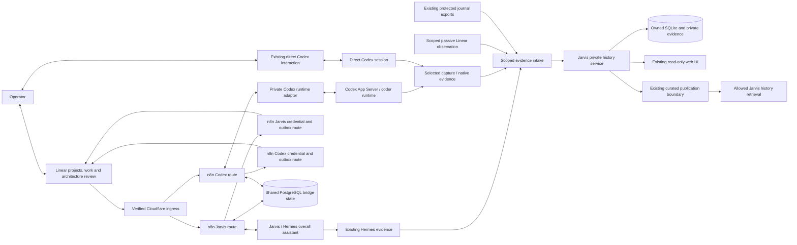

# Standardized History Reporting Format and Rules

Architecture document — **draft v0.4, for human review**  
Date: November 7, 2026, America/New_York  
Repository: `jarvis`  
Project: **Standardized History Reporting Format and Rules**  
Purpose: durable engineering reference and debugging, with Jarvis/Hermes as the overall assistant and Codex as the coder/engineer, independently reachable in Linear.

**Revision in one paragraph:** reuse the existing verified-ingress → n8n → runtime integration pattern for both agents. Preserve Jarvis's existing Linear app and functioning Hermes route. Add a separate **Codex** Linear app, its own n8n-managed OAuth credential, and an authenticated Codex runtime adapter. Codex must support **both direct @mentions and issue delegation**, including follow-ups, replies as Codex, and direct human architecture decisions. Use the supported Codex App Server as the runtime interface. Retain the owned engineering-history database, web UI, capture evaluation, lightweight architecture oversight, and the same eight work items. A new standalone OAuth/token-custody and messaging service is no longer the proposed deployment.

### Revision scope and review status

The human approved [v0.3](STANDARDIZED-HISTORY-REPORTING-FORMAT-AND-RULES-ARCHITECTURE-DRAFT-v0.3-20261107.md), and source implementation began under that agreement. The human subsequently paused the build to examine the existing Jarvis/n8n integration and requested this new revision before implementation resumes. **v0.4 is a complete review candidate, not an approved governing version.** The earlier agreement and records remain retained; affected build work stays paused pending review of this revision. Earlier versions are unchanged.

| Area | v0.4 change or clarification |
| --- | --- |
| Integration infrastructure | Reuse the existing n8n and verified Cloudflare ingress pattern; no parallel custom OAuth callback/token vault or general messaging service. |
| Agent identities | Keep Jarvis's existing app; add a distinct Codex app and credential. Shared infrastructure does not merge identity or runtime ownership. |
| Codex entry points | Both `app:mentionable` and `app:assignable` are mandatory, separately tested. |
| Runtime | A narrow private adapter connects n8n to Codex App Server and retains thread/turn bindings. It does not send Codex requests through Hermes. |
| Availability | Codex remains usable when Hermes or the Jarvis-specific route is unavailable. n8n, verified ingress, and bridge PostgreSQL are shared dependencies; their outage can affect both Linear paths. |
| Existing Jarvis behavior | Preserve working Jarvis authorization, routes, and restricted Linear-originated tool access. No Jarvis app replacement or incidental credential rotation. |
| Reliability | Add explicit session-unavailable, uncertain-response, duplicate, cancellation, and cross-agent routing acceptance. Historical dead letters are diagnostic evidence, not proof of a current failure. |
| Work and data | Retain the eight stable SHRR plan IDs and existing Linear/history mappings. Transport state stays separate from durable engineering history. |

The operator reports that the n8n/database network outage has been fixed and Jarvis interaction with Linear was successfully verified. This document treats that as **operator-reported verification**, not a fresh agent-run end-to-end test. Earlier read-only inspection found enabled workflow definitions and historical successes; enabled configuration alone did not establish runtime health. Existing dead-letter records are not cleared or replayed by this revision.

This revision creates only this Markdown document. It does not modify source code, n8n workflows, Cloudflare, app registrations, credentials, Linear objects, production history, or governing-version designation. It starts no models and does not authorize new paid runs. References to incomplete deliverables are requirements, not claims of completion. This project remains separate from the completed **Engineering History Workspace v0.2** effort.

## 1. Purpose and success criteria

The system should let the operator and Jarvis reconstruct engineering work after the original conversation has ended. It should preserve intent, alternatives, failed attempts, changes, validation, and operational outcomes, with enough source evidence to distinguish a reported conclusion from a verified result.

The two original problems remain central: recording did not start automatically when interactive work began, and several independently assessable deliverables were represented by one conversation-sized work item. Session capture addresses the first problem; explicit architecture work items and consistent Linear/Jarvis identity address the second.

Success means answering these questions with dated records and source references:

1. What problem was being solved, and what architecture did the human agree to?
2. What distinct work items were planned, and which actually happened?
3. Was work requested directly from Codex or handed off by Jarvis? Which agent performed each action?
4. What was tried, what failed, and why was the final approach selected?
5. Which code, tests, review, merge, deployment, and runtime checks support the result?
6. What is unknown, missing from capture, deferred, or inconsistent with the plan?
7. Can the operator discuss work and architecture decisions directly with either named Linear agent, including Codex when Jarvis is unavailable?

The main deliverable is reliable engineering knowledge. A board status or a saved transcript alone is insufficient to establish completion.

## 2. Decisions carried into this proposal

| Area | Direction |
| --- | --- |
| Project architecture | Every project has a versioned architecture document, without exceptions. A human agrees to the governing version before implementation. The document contains the corresponding work breakdown. |
| Organization | Linear is the shared working project/issue and agent-conversation interface. Reuse the existing n8n/verified-ingress bridge with distinct Jarvis and Codex app identities, credentials, routes, and runtime bindings. |
| Agent roles and alignment | Jarvis/Hermes is the overall assistant; Codex is the coder/engineer. Each is separately mentionable and delegatable in Linear, with its own actor identity, sessions, and responses. Shared project/work identity does not merge the agents. |
| Direct Codex path | The operator may start and continue with Codex directly in Linear or the existing interactive coding surface, including architecture review and deviations. Jarvis participation is optional. |
| Agent handoff | Jarvis and Codex exchange explicit context and responsibility through the mapped Linear issue. A handoff does not create a second execution work item or imply human approval. |
| Capture | Evaluate SpecStory and Entire. Prefer an existing capture mechanism over building another general recorder. |
| Human oversight | Review the initial architecture and material architecture deviations. Do not require approval for every work item, checkpoint, command, test, or handoff. |
| History ownership | Keep the private Jarvis history service, database, retained documents, and developing read-only web UI. |
| Existing grouping | One repository/category per project; one primary project per assigned work item. `jarvis-non-git` remains the sole non-Git category. Baselines remain Git commits. |
| Integration scope | Use the existing n8n installation for OAuth, verified-event routing, durable delivery, and runtime reconciliation. Add only the Codex route/adapter and bounded changes needed for safe two-agent operation. |
| Exclusions | No new formal approval/workflow platform, generalized n8n orchestration framework, autonomous scheduler, custom approval dashboard, replacement coding runner, or second standalone OAuth/token-custody service. |

Existing execution, spending, repository, merge, and deployment permissions remain in force. Architecture agreement defines intended work; it does not grant new machine privileges or silently remove existing operational controls.

## 3. Research findings and capture recommendation

### 3.1 SpecStory and Entire

| Question | SpecStory | Entire CLI |
| --- | --- | --- |
| Documented approach | Exports native agent conversations to local Markdown. | Hooks connect agent sessions with Git checkpoints and commits. |
| Codex | Documented CLI integration reads existing session history and supports background watching. Actual desktop/remote layouts still require testing. | Codex is listed as supported. Actual desktop and managed-worker behavior still require testing. |
| Existing conversations | Explicit export of previously created Codex sessions is documented. | Do not assume arbitrary old-chat backfill; test the supported checkpoint/session recovery paths. |
| Storage | Markdown exports; custom output location is available. | Local metadata plus checkpoint Git storage and commit references. |
| Main fit | Capturing conversations, including research that produces no commit. | Tracing committed code back to agent evidence. |
| Main concern here | Export completeness and mapping across sessions/projects. | Hook compatibility and preventing unintended transcript publication to Git remotes. |
| Hermes | Native support was not established by the documentation reviewed. | Native support was not established by the documentation reviewed. |
| Cost boundary | Free, open-source CLI; hosted services are a separate choice. | MIT-licensed CLI; hosted forge/memory features are a separate choice. |

Sources: [SpecStory overview](https://docs.specstory.com/), [Codex integration](https://docs.specstory.com/integrations/codex-cli), [CLI reference](https://docs.specstory.com/integrations/terminal-coding-agents/usage), [Entire CLI](https://github.com/entireio/cli), and [Entire session/checkpoint architecture](https://github.com/entireio/cli/blob/main/docs/architecture/sessions-and-checkpoints.md).

**Provisional recommendation: evaluate SpecStory first as the primary Codex capture source, with Entire as the comparison candidate for stronger commit correlation.** Do not enable both by default. Select one after demonstrating the required coverage, or record that neither meets it.

This is an architectural preference, not a completed benchmark. Entire's support for commit-less snapshots means it must not be dismissed simply as commit-only; the test must establish what is retained automatically for research and interrupted sessions. Documentation and implementation evolve, so evaluation records must pin exact versions and settings.

### 3.2 Capture privacy and compatibility

SpecStory documents optional cloud synchronization and configurable analytics/telemetry. Entire documents checkpoint uploads to Git remotes and best-effort redaction. A separate Git ref is still publication of transcript content. [SpecStory privacy](https://docs.specstory.com/privacy), [SpecStory configuration](https://docs.specstory.com/integrations/terminal-coding-agents/usage), [Entire security](https://docs.entire.com/security).

The proposed evaluation therefore uses disposable repositories, synthetic transcripts, local output, no cloud account, disabled optional telemetry, and no transcript pushes. Verify those settings and actual behavior for the selected release before any real-history pilot. Never install hooks into the production checkout as part of research.

Native session files stay under their existing agent owner. Export only the selected engineering sessions. Collectors do not need provider credentials, another agent's authentication files, or privileged workflow journals. Redaction reduces exposure but does not prove that arbitrary transcript content is safe to publish.

### 3.3 Hermes evidence

Current Hermes documentation describes native session persistence, search, and stored tool interactions. These are useful existing sources; their current upstream layout is not proof of what this installation runs. [Hermes sessions](https://hermes-agent.nousresearch.com/docs/user-guide/sessions), [session storage](https://hermes-agent.nousresearch.com/docs/developer-guide/session-storage).

Inspect the installed version and supported read/export surface during implementation. Prefer an existing supported export or a small read-only normalizer over changing Hermes internals. For Hermes-coordinated Codex work, capture the coordinator session and the worker evidence separately. Existing managed journal/export records remain the source of protected execution facts.

If complete Hermes session capture requires a substantial new recorder, do not expand this project silently. Deliver the agreed structured reporting and existing managed evidence, display the capture gap, and bring that additional scope back for architectural review. Enabling unattended Hermes execution remains outside this project.

### 3.4 Capture selection test

Run both candidates against the same model-free fixtures and expected results. Use a separately authorized real-session pilot only after fixture success.

| Required case | Evidence to retain |
| --- | --- |
| Existing and newly created Codex session | Expected exchanges, identities, timestamps, and export contents; no manual request to record each turn. |
| Desktop/CLI and remote-workspace layouts actually used | Exact supported paths/formats and an explicit pass, failure, or unsupported result for each surface. |
| Research without edits or commit; interruption before finish | Recoverable source evidence and honest partial/final status. |
| Resume, compaction, compression, or source rotation | Preserved lineage, missing ranges if any, and repeatable restart behavior. |
| Two projects sharing one repository; a work switch in one chat | Explicit work associations; no assignment based solely on repository or time proximity. |
| Managed worker leaves changes uncommitted | Evidence survives worker cleanup and links to later publisher/validation records. |
| Handoff from Hermes to Codex | Distinct coordinator/worker identities connected to one work item. |
| Repeated export or lost intake response | No duplicate sessions, work items, or history events. |
| Privacy and hook coexistence | No unexpected upload, source change, damaged existing hook, or credential capture. |
| Export portability and resource use | Independent local readback, practical storage/CPU behavior, pinned configuration, and uninstall/recovery notes. |

Mandatory selection conditions are coverage of the actual work surfaces, private export, recoverability, and compatibility with current development controls. Prefer the least additional machinery among candidates that meet those conditions. A failure of both is a decision point, not authorization to build a replacement capture platform.

## 4. Components and ownership

The Jarvis and Codex routes share integration infrastructure but have distinct credentials, session ownership, queue selection, and runtimes. A supported direct desktop/CLI continuation is linked explicitly; the diagram does not claim this exact desktop chat is remotely writable. Codex communication through Linear does not require Hermes to run. A shared n8n/ingress/database outage can interrupt both agents' Linear paths. The direct operator/Codex surface remains available within its own connectivity and permissions.

n8n handles integration transport and operational coordination. It does not become an architecture approval engine, a general autonomous work scheduler, or the authority for durable engineering history. Hermes does not acquire the private history database/socket, and the browser remains read-only.

| Information | Authoritative location / responsibility |
| --- | --- |
| Current planned work, issue ownership, discussion, and board status | Linear. |
| Named agent participation and incoming message routing | Separate Jarvis and Codex Linear apps, n8n credentials/routes, and corresponding runtime bindings; each response is attributed to its actual agent. |
| Delivery and runtime coordination state | Existing PostgreSQL `linear_bridge` infrastructure, extended additively for app-scoped receipts, sessions, dispatch, outbox, and reconciliation. This is operational state, not the engineering archive. |
| Linear OAuth custody | n8n credential storage, using a distinct credential per app. Runtime workers receive neither credential. |
| Exact retained governing architecture, designation history, Git baselines, historical project membership | Existing Jarvis project/history service. |
| Architecture drafting/review presentation | Markdown files and/or Linear document/resources; publication copies reference the retained version. |
| Native conversation | The original agent store; an export is evidence derived from it. |
| Retained engineering evidence and historical observations | Jarvis-owned storage, with immutable manifests and provenance. |
| Code and PR contents | Git/GitHub. |
| Protected execution, validation, and publication facts | Existing trusted records and their explicit exports. |
| What an agent may retrieve | Existing curated-history boundary and explicitly authorized scopes. |

Linear is the working coordination interface; Jarvis preserves historical observations and evidence. Neither side silently overwrites the other's historical records. Linear deletion, renaming, or an outage does not delete the owned engineering archive.

## 5. One work model across Hermes and Codex

### 5.1 Identity and decomposition

A project has one stable Jarvis project ID and one mapped Linear project UUID. A distinct engineering deliverable has one architecture plan ID, one Linear execution issue UUID, and one Jarvis work ID. Human-readable Linear identifiers and URLs are display references, not durable identity keys.

The mapping includes the Linear workspace/team scope, repository/category, architecture document/version/digest, and history work revision. Do not create a second project or work item when the agent changes.

An independently testable capability, investigation result, or corrective deliverable deserves a work item. Commands, retries, commits, checkpoints, and individual chat turns normally do not. An attempt is activity within a work item; a session is a conversation that can span several work items.

Architecture-review/deviation issues are **decision records**, distinguished from execution issues. They do not inflate delivered-work counts. Parent grouping issues need not become duplicate Jarvis work items. The explicit execution-issue mapping determines counting.

Plan refinements inside already agreed scope may split an oversized deliverable without another human approval: retain the parent plan entry, add traceable child IDs, and preserve the old mapping. New outcomes or changed architectural commitments use the deviation process. Never retire a plan ID and reuse it for unrelated work.

### 5.2 Two named agents and direct communication

**Separate Linear agents are required in this version, not optional future integration.**

| Agent | Primary role | Operator interaction |
| --- | --- | --- |
| **Jarvis** (Hermes) | Overall assistant: understand broader intent, organize and research efforts, maintain continuity, coordinate work, and use its existing assistant tools within their permissions. | Address Jarvis directly for assistant work, context, planning, or coordination. Jarvis can prepare a bounded engineering handoff to Codex. |
| **Codex** | Coder/engineer: investigate technical problems, develop the architecture, implement agreed work, validate results, explain deviations, and report engineering evidence. | Address Codex directly for engineering work or architecture decisions. Codex asks the operator directly for needed agreement; it does not require Jarvis to relay or endorse the exchange. |

These are distinct app actors, not labels on an operator account, two issue queues, or an alias that forwards every request through Hermes. The operator remains the human decision maker. Jarvis is not an additional approver above Codex, and Codex cannot approve its own architecture or material deviations.

| Scenario | Required behavior |
| --- | --- |
| Operator → Codex in Linear | Codex receives the addressed message, replies as Codex, and works against the mapped issue/architecture. Jarvis need not run, receive the message, or participate. |
| Operator → Codex in the current interactive coding style | Continue directly. Associate relevant context, reports, and decisions with the same Linear/Jarvis records; adopting Linear does not force the conversation through Jarvis. |
| Operator → Jarvis | Jarvis answers as the overall assistant. Engineering execution is normally handed to Codex when it needs the coder/engineer role. |
| Jarvis → Codex | Jarvis records the bounded request and handoff on the existing issue, directs it to Codex, and transfers the active engineering responsibility. Codex acknowledges as Codex. |
| Codex → Jarvis | Codex reports an engineering result or requests assistant context using the same issue or an explicitly linked context issue. Jarvis responds as Jarvis; this does not automatically return engineering ownership to Jarvis. |
| Codex needs architectural agreement | Codex presents the exact change to the operator in its own Linear conversation or direct interaction and waits only on affected work. No Jarvis mediation or second signoff is required. |
| Hermes/Jarvis-specific route unavailable | Direct operator/Codex conversation, decisions, and authorized engineering work remain usable while shared infrastructure is healthy. |

A shared issue can contain exchanges with both agents. Human ownership, the current delegated agent, and historical contributors are different concepts. Use the platform's supported delegation model and an explicit current executor; do not assume one issue can have two simultaneous active delegates. The human may talk to either agent without transferring execution responsibility on every message.

### 5.3 Handoff contract

A handoff preserves the project/work/plan IDs, issue UUID, governing architecture version/digest, current work revision, current code/branch/worktree, useful evidence, remaining work, and the requested recipient/action. Record sender and recipient agent IDs plus the source message/session reference. On receipt, the target acknowledges the handoff and records its own session/attempt binding. Retransmission must not start a second attempt or create duplicate issues.

A handoff is the transfer of context or agreed work, not a new approval gate. Routine in-scope handoffs need no extra human approval. A new outcome or material design change still goes to the operator. Stop the prior executor's overlapping edits before the recipient starts; a request for advice does not transfer ownership. Preserve the distinction between requested, accepted, and completed handoffs.

Only directed mentions, delegated work, or messages addressed to an existing agent session activate the matching agent. Do not make both agents react to every comment. Ignore self-authored echoes and replayed events; correlate handoffs and bound automatic replies so the agents cannot create an endless conversation loop. Native agent-to-agent mention/delegation behavior must be tested. If Linear does not emit the required event for an agent-authored handoff, use the same thin adapter to deliver a correlated request through a supported API path and retain its Linear reference; do not require the operator to manually repeat every handoff or claim that an ordinary comment guarantees delivery.

### 5.4 Existing integration baseline and reuse decision

The existing Jarvis integration was inspected read-only before this revision. Historical source describes four workflows, and database inspection confirmed their enabled/published definitions:

| Existing component | Role | v0.4 treatment |
| --- | --- | --- |
| Cloudflare Worker and dedicated tunnel ingress | Verify Linear webhook signature/time and forward to a private n8n route. | Reuse the boundary; configure Codex-specific verification and routing. Fresh edge end-to-end acceptance is still required. |
| Linear Inbound Tasking v2 | Persist delivery/session context and dispatch restricted Hermes runs. | Preserve Jarvis; add separately addressed Codex ingress/dispatch. |
| Hermes Run Reconciler | Observe Hermes completion and queue replies. | Preserve; use Codex-specific runtime-event reconciliation for Codex. |
| Linear Outbound Response | Store and publish native Agent Activities. | Reuse with explicit app-to-credential ownership and isolated queue claims. |
| Linear Action Gateway and `linear-action-mcp` | Authenticated, audited, allowlisted issue/comment actions. | Preserve Jarvis's surface; reuse appropriate patterns for Codex without sharing Jarvis credentials or expanding tool access. |
| PostgreSQL `linear_bridge` tables | Receipts, Hermes session/run mapping, outbox, action audit. | Extend additively or add app-scoped tables. Existing Hermes-specific records retain their meaning and bytes. |

The October integration record is [IMPLEMENTATION_STATUS.md](/home/shanereviello/Documents/Codex/2026-10-07/files-pasted-by-the-user-jarvis/IMPLEMENTATION_STATUS.md). It documents signature validation, restricted Hermes tools, native activity delivery, and earlier read/write/follow-up acceptance. November 7 read-only inspection established configuration and historical state; the operator subsequently reported repairing an infrastructure outage and verifying current Jarvis/Linear interaction. None of these facts establishes Codex acceptance yet.

**Reuse decision:** retain n8n's OAuth, webhook, durable-delivery, and coordination responsibilities. Implement the Codex runtime boundary and safe two-agent routing, rather than deploy a second service that duplicates OAuth callbacks, token storage, a public webhook inbox, and an outbound queue. Useful existing source contracts/tests may be adapted; source already written is not an obligation to deploy that design.

### 5.5 Separate app identities and required permissions

Keep the existing **Jarvis** app/actor and authorization. Register **Codex** as a separate native Linear app, with its own actor ID, OAuth credential, signing secret, and selected workspace/team access. Codex must use `actor=app` and both of these permissions:

| Codex permission | Required operator interaction | Acceptance |
| --- | --- | --- |
| `app:mentionable` | Address `@Codex` directly in Linear. | Codex receives the mention, acknowledges, replies as Codex, and handles a follow-up in the correct session. |
| `app:assignable` | Delegate an issue to Codex. | Linear records Codex as delegate and the human remains assignee; the correct work/runtime binding starts and produces a Codex response. |

These entry points do not create per-action approval gates or automatically grant host, repository, spending, merge, or deployment authority. An advisory mention does not itself transfer active engineering ownership. Delegation establishes responsibility for the addressed work; it does not imply approval of an unagreed architecture. [Linear agent setup](https://linear.app/developers/agents).

Inspection of installed n8n 2.28.3 credential code showed support for the Application actor, but default application scopes included `app:mentionable` without `app:assignable`. This describes the installed default, **not the saved Jarvis token's actual permissions**. Explicitly obtain and verify both permissions for Codex. Use the built-in credential if it supports the required complete configuration, or n8n's standard generic OAuth2 credential if necessary; neither path requires a custom token vault. Do not modify or reauthorize Jarvis incidentally. n8n documents Application actor authentication and using its displayed OAuth Redirect URL for the Linear callback. [n8n Linear credentials](https://docs.n8n.io/integrations/builtin/credentials/linear/).

The new registration must use **the OAuth Redirect URL displayed by the chosen n8n credential**, verified before installation. The previously proposed `https://jarvis-agents.reviellorobotics.com/oauth/codex/callback` is superseded as the OAuth target. The previous standalone webhook address is also not a registration instruction: finalize a Codex-specific route through the existing verified ingress and test it before installation. OAuth callback and webhook delivery are separate endpoints. Keep all secrets private; share only public registration identifiers in review material. Do not create a replacement Jarvis app.

### 5.6 Verified routing, transport state, and runtime ownership

Each received event must bind the configured Linear organization, intended app/actor, Linear agent session, source activity/delivery, and mapped issue to the recipient runtime. Verify raw-body signatures, timestamp/replay bounds, and Codex's own signing secret at the trusted edge. Do not reuse the Jarvis signing secret. A forwarded verification assertion is accepted only through the authenticated trusted-ingress path; a caller-supplied header on a public bypass must not suffice. Reject cross-app, wrong-organization, and mismatched session/issue events before dispatch.

Persist durable receipt and pending-dispatch state before acknowledging delivery. Scope idempotency keys to organization/app/source event; store raw sensitive payloads only in admitted private storage. Session/run/outbox records identify app actor, role, target runtime, Linear session/activity, issue UUID, attempt, and credential binding. Existing keys such as `linear:<organization>:<session>` and Hermes-specific columns must not be copied as if they already provide two-agent isolation. Add a bounded migration or separate tables with compatibility and rollback evidence.

Credential selection comes from a trusted app-to-credential mapping, never from prompt text, arbitrary webhook fields, or worker output. A Jarvis queue worker cannot claim Codex deliveries, and vice versa. Neither route changes the other's current session/executor binding. Existing Jarvis Linear-originated Hermes runs retain their restricted Linear-actions toolset; this project does not grant them terminal, filesystem, or repository execution.

Jarvis and Codex activate only on directed mentions, delegation, or addressed session messages. Ordinary comment observation does not launch a worker. Preserve the Section 5.3 handoff contract and test both native agent-to-agent directions. If the platform does not emit a needed native event, use a bounded authenticated request through this bridge with a retained Linear reference. Prevent self-echoes, duplicate launch, and unbounded agent reply loops.

### 5.7 Codex runtime adapter and session continuity

Use a narrow authenticated private adapter between n8n and **Codex App Server**. The supported interface provides `thread/start` and `thread/resume`, `turn/start`, streamed notifications, and `turn/interrupt`. Pin the installed version and demonstrate compatibility before activation. Store returned thread, session-lineage, and turn identifiers separately rather than deriving them from Linear identifiers. [OpenAI Docs: Codex App Server](https://learn.chatgpt.com/docs/app-server).

The adapter accepts admitted issue/work/architecture context and a bounded requested action; it is not an arbitrary command-execution endpoint. Bind it to the existing authorized sandbox, tools, repository/worktree, and execution controls. n8n owns Linear OAuth; the Codex runtime owns its existing provider authentication. Neither app credential is passed to a worker, and n8n does not need a provider credential. A generic text-generation node labeled Codex is insufficient.

Serialize work per active runtime thread and prevent overlapping editing ownership across linked desktop/managed sessions. Preserve follow-up order, correlation, progress, completion, interruption, and error results. On a stop signal, request actual cancellation for the matching active turn and report the observed outcome; merely adding a stop instruction to another prompt does not establish cancellation. If work was already completed or cancellation cannot be confirmed, report that accurately.

This design does not assume a Linear mention can inject into this exact running desktop conversation. Where supported, resume a correctly bound session. Otherwise use an explicitly linked Codex continuation with the same work identity and retained handoff. Direct operator questions, architecture decisions, and follow-ups must reach that Codex session and receive Codex replies without Hermes mediation. Desktop/Linear continuation behavior must be demonstrated, not inferred from having MCP installed.

Runtime completion and Linear response delivery have different states. Persist native results before publishing responses so a failed Linear write does not cause engineering work to run again. After a restart or uncertain dispatch, reconcile the known runtime/thread/turn state before retrying; do not blindly launch another turn. Use supported client identifiers where available and retain an explicit unresolved state when reconciliation cannot establish the outcome.

### 5.8 Delivery reliability, attribution, and shared dependencies

Reuse the durable outbox with app ownership, bounded retry/backoff, leases, and visible terminal failures. A dead letter means an outgoing delivery could not be completed; it is not automatically a lost task, a failed engineering result, or a revoked OAuth token. Earlier inspection found 14 sent and 13 historical dead-letter messages categorized as session unavailable. Their exact root cause was not established; they are historical diagnostic evidence, not current health status.

Treat an unavailable/expired Linear agent session differently from an authentication failure or temporary network outage. Preserve the result and failed target, expose the delivery state, and offer recovery through a supported permitted destination or an explicit linked continuation. Do not blindly replay old results into another issue, manufacture a human decision, or rerun work to obtain a replacement response. Historical failed messages are not automatically replayed when deploying Codex.

A lost response after a successful Linear write is an uncertain outcome. Prefer stable client-generated activity identifiers and reconciliation where supported by the pinned API. If reliable deduplication cannot be established, preserve an uncertain delivery for inspection instead of automatic duplicate publishing. Local outbox idempotency alone cannot guarantee exactly-once remote effects. Apply the same principle to runtime dispatch and handoff acceptance.

Codex's Linear route must work with Hermes stopped or unavailable, and a Jarvis-specific route failure must not be a prerequisite for Codex dispatch. **Shared n8n, ingress, PostgreSQL, host/network, and Linear availability remain common dependencies.** This revision adds no second highly available integration stack. Direct desktop/CLI Codex work can continue under existing authority during a bridge outage, with coordination/history updates queued where possible and coverage limits shown.

Put the common reporting convention in repository guidance and deliver role-specific work/architecture context to both runtimes. Linear content is evidence and task context, not authority to override repository/runtime instructions. Record app/actor, Linear session/activity, native runtime session/thread/turn, human/coordinator/executor, and submitting service principal separately. Agent-authored messages cannot establish human agreement. Existing operator-token MCP writes retain their attribution limits. [Linear interaction](https://linear.app/developers/agent-interaction), [Linear MCP](https://linear.app/docs/mcp).

## 6. Lightweight architecture oversight in Linear

### 6.1 What Linear provides

Linear has project documents with version history, issue templates, comments, and configurable issue/project statuses. These can present a review request without another application. Its GitHub reviews concern pull requests; they are not proof of approval of a separately identified architecture. [Documents](https://linear.app/docs/documents), [templates](https://linear.app/docs/issue-templates), [issue statuses](https://linear.app/docs/issue-property), [project statuses](https://linear.app/docs/project-status), [PR reviews](https://linear.app/docs/diffs).

**Proposed convention:** one `architecture-decision` issue for each version or bundled deviation requiring human agreement, using the existing team workflow where practical. Its contents identify the project, exact proposed architecture version/digest, readable content, change summary, affected plan IDs, and the decision requested. A single decision may approve several related architectural changes.

Statuses such as `Awaiting architecture review` and `Resolved`, plus labels, make these requests easy to find. They are coordination aids, not a new execution-enforcement service. No per-test, per-command, or per-checkpoint review issues are created.

### 6.2 Agreement and version handling

1. Retain the candidate Markdown version in Jarvis and link it from the Linear review issue. Linear may hold a convenient draft copy, but the decision identifies the exact retained bytes.
2. The operator gives an explicit decision, preferably a comment identifying the version and digest. This can be a direct reply to Codex in Linear, a direct operator/Codex conversation such as the current interaction, or an operator/Jarvis exchange. Retain the source reference; Jarvis forwarding or countersigning is never required for a direct Codex decision.
3. Record that decision and explicitly designate the agreed version through the existing operator/history interface. This remains a lightweight recording operation, not a new approval engine.
4. Link the decision and governing version from the Linear project and execution issues. Work proceeds under that agreement without repeated approvals. Codex can receive and record the operator's decision through the authorized path without waiting for Jarvis to relay it.

If a connector acts as the operator, an imported comment has the connector's attribution limits. Where human authorship cannot be independently established, retain an operator attestation through the existing operator interface; do not elevate an agent-written comment into human agreement. No autonomous status-to-approval conversion is proposed.

A later edit, a resolved comment, a reaction, or moving an issue to Done does not change the agreed version. New drafts remain drafts. Documentation-only corrections may be saved with their change classification while the preceding agreed design continues to govern. Material changes require human agreement before the affected implementation proceeds. Closeout retains an as-built reconciliation and any decisions that explain differences.

### 6.3 What needs the human's attention

| Situation | Behavior |
| --- | --- |
| Initial architecture | Obtain agreement once before implementation. |
| Change to outcomes, exclusions, data ownership, external publication, significant dependencies, trust boundaries, public interfaces, or important storage/retention behavior | Present a material deviation with options and consequences. Pause only affected implementation; continue independent in-scope work. |
| Refactoring, routine tests, retrying a failed test, implementation detail within agreed boundaries | Proceed and record useful engineering evidence. |
| Breaking one large item into equivalent child deliverables within the same accepted scope | Update the work mapping with a reason; no new approval solely for decomposition. |
| Bug discovered during implementation | Fix within the agreed acceptance scope; use a separate corrective item when independently assessable. Escalate if the solution changes architecture materially. |
| Merge, deployment, paid execution, or privileged action | Follow the existing authority for that action. Linear status does not replace it. |

Every project, including non-Git and historical projects, still needs an architecture document. Retrospective documentation must label what is reconstructed and what was not agreed at the time. Do not manufacture past approvals. Existing projects with missing documents remain visible as incomplete documentation; remediation is explicit and does not erase their history.

## 7. The engineering record to preserve

### 7.1 Data and relationships

The following is a logical target, not a claim that these fields already exist in the current contracts.

| Record | Minimum useful content |
| --- | --- |
| Project / work mapping | Stable IDs, scope, Linear UUIDs/URLs, plan ID, work revision, architecture pin, mapping change reason. |
| Session association | Named agent and Linear app/actor ID, Linear agent-session/activity IDs, native runtime session ID, parent/resume lineage when available, host/workspace identity, capture source/version, and association to work/attempt. |
| Attempt / handoff | Coordinator if present, executor, sender/recipient agent IDs, directed request and source reference, requested/accepted/completed state, attempt ID, managed task/run IDs where applicable, start/end or interruption, previous attempt, branch/worktree and Git baseline. |
| Engineering checkpoint | Problem/context, observation, approach or decision and rationale, meaningful change, validation, failures, unresolved questions, evidence references, next useful step. |
| Validation evidence | Criterion, command/test identity, code revision, actual result, relevant output/artifact digest, environment and provenance limits. |
| External observation | Linear object/version or content digest, source/observed times, observed actor, relevant issue state or discussion, import identity. |
| Architecture decision | Exact version/digest, material delta, affected work, decision/source, human-attribution basis, designation reference, and the direct agent/conversation receiving the decision. Jarvis involvement is optional. |
| Capture artifact | Source identity/range, immutable exported bytes or chunk references, SHA-256, format, size, capture time, redaction profile, coverage and limitations. |
| Outcome | Delivered/failed/deferred/cancelled state for the exact work revision, acceptance evidence and open limitations. Merge/deploy/runtime facts remain separate linked evidence. |

One project contains many work items; one work item can have many attempts and sessions. A session can contribute to several work items, using explicit message/turn ranges where the source supports them. Otherwise label the link as session-level context, not proof that every exchange belongs to every linked work item.

Preserve source occurrence time separately from capture/import time. Unknown tokens, cost, timing, model, or identity stay unknown. Do not sum coordinator and worker counters without checking whether one already includes the other. Missing tool output is a coverage limitation, not an invented successful result.

### 7.2 Reporting cadence

At work start, establish the issue/work/architecture context and record a starting checkpoint automatically through the integration. Capture conversation evidence in the background. Agents contribute concise structured checkpoints after a meaningful finding, failed approach, design decision, validation result, handoff, or interruption—not after every shell command.

At finish or pause, record what changed, what was validated, remaining uncertainty, and the next step. A crash can leave the last captured exchange and an interrupted attempt without a fabricated completion report. Normal reporting does not require the user to ask to create history.

| Reporting field | Purpose |
| --- | --- |
| Context and work references | Identify the exact deliverable and agreed design. |
| Observation / result | State what actually happened. |
| Reasoning / alternatives | Explain why this approach was chosen and what was rejected. |
| Change | Describe the code, configuration, document, or operational effect. |
| Validation and evidence | Link the relevant proof and its limits. |
| Open questions / next step | Preserve continuity for another session or agent. |

Session transcripts are evidence of visible exchanges, not access to private internal model reasoning. Structured explanations are attributed engineering reports, not automatically verified facts.

## 8. Intake, storage, synchronization, and recovery

### 8.1 Reuse and additive extension

Keep the existing service-owned SQLite database, scoped Unix API, immutable work/project/scope events, exact document versions, receipts, and read-only dashboard. The history foundation source reviewed for v0.3 was `705f69c057a1e2b6e134d61a69519c409928425d`; the operator reported production merge `354a893999b5006bdf3c31175f4e52d8d0306478` and schema version 3. This project subsequently produced source changes under v0.3. Foundation provenance and implementation progress do not establish deployment or full acceptance. Confirm the actual current release/schema before any additive migration; this draft performs no production audit or migration.

Existing contracts have strict fields and bounded request sizes. Implement new mappings, attempts, capture manifests, and decision observations through explicitly versioned additive contracts/tables where needed. Do not hide structured relationships in narrative strings or bypass the service to insert database rows. Preserve previous bytes, receipts, document versions, and signed snapshot behavior.

New historical views must pin the new record streams and exact artifact revisions as well as the existing work/project/scope boundaries. Older signed views must remain reproducible and represent the new streams as unavailable at that boundary; never join an old closeout to today's mappings or captures. Read projections and indexes remain rebuildable from retained records.

Large exports belong in service-owned private evidence storage with immutable manifests referenced from the database. Final path, size/chunk limits, quotas, migration version, and backup integration are implementation details to specify in the intake contract. Existing small work/document requests must not be silently overloaded with entire growing transcripts.

Retain source-native files under their original owner, normalized/redacted engineering exports in owned evidence storage, and structured history in the database. Linear receives concise context, decisions, and links rather than full transcripts or raw logs. Repository commits contain source and appropriate documentation, not private session exports.

### 8.2 Delivery and association

Use a durable local spool and stable source-event keys. A repeated identical export returns its existing receipt; a changed export creates a new immutable artifact revision. Appending to a growing session must not rewrite previously retained evidence. Capture cursor, parsed range, artifact digest, and intake receipt make replay auditable.

Explicit issue/work context determines association. Repository identity alone is insufficient because several projects may share a repository. Unknown associations stay in a visible pending/unmapped view. Correcting an association appends a correction; it does not rewrite the original import.

### 8.3 Linear synchronization

Start with an outbound, scoped polling adapter using a supported authenticated read path for the selected workspace/team/projects. Reuse the existing gateway when its actual operations and pagination are sufficient; otherwise use a narrow, separately configured API reader. Do not automate a desktop agent session as the synchronization daemon.

Import relevant object snapshots/discussion with stable IDs and content digests. Follow pagination, preserve source and observation times, tolerate overlap, and reconcile by object identity. Polling cannot promise every intermediate edit or capture a comment deleted between polls; label this limit. Passive history observation does not itself require a public webhook endpoint. Separately, the two interactive agent identities require the native agent-event delivery path described in Sections 5.4–5.8, with signature/identity checks, durable delivery IDs, replay protection, and a clear mapping to the target app/session. Capture those exchanges into history without making the history poller a worker launcher. [Linear webhooks](https://linear.app/developers/webhooks).

Current issue state remains Linear-owned. The history observer appends observations; it does not push status changes back or launch work. Jarvis and Codex make ordinary coordination updates through their separately attributed adapters/tools. Keep incoming agent-event delivery separate from passive history observation. Bookmark/attachment creation and mapping bootstrap use repeatable lookup-before-create behavior, with reconciliation of uncertain writes rather than creating duplicate issues or delivering a handoff twice.

### 8.4 Failure behavior and protection

If history delivery is unavailable, queue evidence durably, show pending/failed delivery, and continue already authorized in-scope work where the context remains known. If Linear is unavailable, use the last exact saved context for current work and queue coordination updates; direct operator/Codex work remains possible. Do not guess a new assignment or architecture decision. If Hermes or the Jarvis-specific route is unavailable, Codex's route remains usable while shared dependencies are healthy. A shared n8n, ingress, or bridge-database outage may affect both agents' Linear paths. If Codex is unavailable, Jarvis may report the outage but must not impersonate a Codex response. Missing governing agreement prevents affected implementation, while research and draft preparation can continue.

Do not silently discard data when storage is full. Stop capture cleanly, report the lost/uncaptured interval, and preserve existing evidence. Initial policy retains ingested engineering evidence without automatic deletion; monitor usage and bring retention changes back as an architectural decision. Backups must include both database and referenced artifacts; this document does not claim the earlier deferred backup/restore work has been completed.

Imported text is untrusted evidence, not new agent instructions. Keep credentials out of exports, restrict paths and scopes, render transcript content as text, and refuse arbitrary artifact-path/URL access. Preserve current authentication and browser failure-clearing behavior. No general private-history mount or new privilege is given to Hermes.

## 9. Web UI and agent retrieval

Retain scope → project → work and the existing five project tabs. Add focused reference features instead of another task board or approval editor.

| Existing area | Proposed addition |
| --- | --- |
| Project Overview | Linear project link, governing architecture and human-agreement source, planned/mapped work counts, and capture/sync freshness. |
| Project Work | Architecture plan ID, Linear issue link, named active agent/delegate, optional coordinator, current work revision and latest meaningful result. Distinguish decision/grouping issues from execution work. |
| Architecture | Existing exact versions/diffs plus decision/deviation links and coverage of the architecture work breakdown. |
| Baselines | Preserve Git-only versions; connect relevant attempts and deployment evidence without inferring that every commit was deployed. |
| Project History | Mapping changes, Jarvis/Codex handoff requests and acknowledgments, direct operator/Codex architecture decisions, imports, closeout, and outstanding capture gaps with source attribution. |
| Work Timeline / Evidence | Attempts, session lineage, failure/decision/validation checkpoints, immutable export references, and capture completeness. |

The browser remains read-only. Open Linear for coordination and human discussion. Never label an issue status as verified deployment or an agent-authored decision as authenticated human approval.

Jarvis retrieval should return concise engineering answers with exact project/work/architecture/evidence references. Reuse the curated publication boundary: the operator's private archive is not automatically made available to Hermes. Establish a reusable publication profile for approved structured fields within selected projects, so normal safe summaries can be published without reviewing every checkpoint individually. It must preserve withdrawal, scope checks, generation semantics, and exclude full transcripts by default. That profile is part of the reviewed implementation, not permission granted by collection alone.

Acceptance must demonstrate retrieval through the actual allowed MCP surface, rather than only browsing the operator UI. Broader transcript access or semantic/vector infrastructure is deferred.

## 10. Work breakdown for this project

These are the same eight execution deliverables established under v0.3. `SHRR-xx` values are stable **plan IDs**; preserve their existing Linear UUIDs and Jarvis mappings. Local creation receipts map SHRR-01–08 respectively to REV-46–53 in Reviello Robotics. The [existing Linear project](https://linear.app/reviello-robotics/project/standardized-history-reporting-format-and-rules-a28a39584792) is reused. Do not create replacement issues, duplicate work, or retroactively mark revised acceptance complete. Any later mapping correction is explicit and append-only. This document does not mutate those objects.

| Plan ID / existing Linear issue | Deliverable | Acceptance result | Dependency |
| --- | --- | --- | --- |
| SHRR-01 / REV-46 | Capture comparison and selection | Pinned SpecStory/Entire fixture results, real-surface coverage matrix, private-output proof, selection rationale, and Hermes gap disposition. Research in this draft is an input, not completed acceptance. | Reviewed architecture |
| SHRR-02 / REV-47 | Linear organization and architecture-review convention | Project/issue templates, plan mapping, decision/deviation examples, and usable human review with no routine implementation approval queue. | Reviewed architecture |
| SHRR-03 / REV-48 | Two Linear agent identities, direct communication, and handoff | Preserved Jarvis app/route plus a separate Codex app with both mention and delegation permissions; n8n-managed OAuth and app-isolated verified ingress/outbox; authenticated Codex App Server adapter; direct follow-ups/architecture decisions and both handoff directions; correlation, real cancellation, replay/loop prevention, and Codex operation without Hermes while shared dependencies are healthy. | SHRR-02 |
| SHRR-04 / REV-49 | Owned history relationships and evidence intake | Versioned additive contracts, immutable mappings/attempts/artifacts, privacy, receipt/replay behavior, and compatibility with existing records/snapshots. | SHRR-01; SHRR-02 |
| SHRR-05 / REV-50 | Capture and Linear observation integration | Automatic selected-source capture/intake, scoped Linear observations, durable delivery, restart recovery, freshness/gap reporting, and no work launching. | SHRR-03; SHRR-04 |
| SHRR-06 / REV-51 | Reference UI and curated retrieval | Focused UI additions and actual MCP retrieval of approved engineering summaries with citations and maintained access boundaries. | SHRR-04; SHRR-05 |
| SHRR-07 / REV-52 | Existing-project architecture reconciliation | Every existing project accounted for with a retained architecture document, truthful retrospective provenance, and explicit unapproved/unknown history where applicable. No fabricated original agreement or new automatic reassignment. | SHRR-02; SHRR-04 |
| SHRR-08 / REV-53 | Acceptance, operating documentation, and staged rollout | Cross-agent synthetic acceptance and authorized live mention/delegation/follow-up checks; historical/uncertain delivery and outage recovery; Jarvis regression evidence; credential/workflow/bridge-state backup and rollback runbook; separately authorized deployment and closeout with an as-built architecture. | SHRR-01–07 |

Each row gets its own execution work item. Attempts, tests, and deployment steps attach to the relevant item. Scope-changing defects become explicitly mapped corrective work; they are not concealed by repeatedly enlarging one conversation-sized work item.

## 11. Project acceptance scenarios

| Scenario | Required outcome |
| --- | --- |
| New project | Retained architecture, explicit human agreement, and work breakdown map to Linear/Jarvis before implementation. |
| Ordinary work start | Correct project/work/architecture context and capture begin without the operator asking to record history. |
| Several deliverables in one chat | Distinct execution work items, explicit switches, no duplicate project or indiscriminate transcript attribution. |
| Two named Linear agents | Jarvis and Codex are separately discoverable, mentionable, delegatable, and visibly attributed; they are not aliases on a shared operator identity. |
| Direct operator → Codex in Linear | Codex receives an @mention and its follow-up, replies as Codex, and binds the actual runtime thread/turn to the issue. No Hermes relay is used. |
| Direct operator → Codex by delegation | Codex is selectable as delegate with `app:assignable`, the human assignee remains, the right mapped work starts, and acknowledgment/result are published as Codex. Mention and delegation paths both pass. |
| Separate authorization and ingress | Codex uses its own app credential/signing secret; wrong org/app/session, forged verification headers, and credential-selection attempts are rejected before runtime dispatch. Jarvis authorization is preserved. |
| Direct architecture decision with Codex | Codex presents a version/deviation; the operator replies directly; exact decision/source and designation are retained without a Jarvis signoff. |
| Hermes/Jarvis-specific route unavailable | Operator/Codex communication and decision recording still function through the Codex route while shared infrastructure is healthy. |
| Shared n8n/ingress/PostgreSQL outage | Both Linear paths report the shared dependency accurately; no claimed Hermes-independent high availability. Direct Codex continuation and pending evidence remain truthful. |
| Existing Jarvis regression | Preserve and recheck Jarvis mention/follow-up/action behavior and restricted tools without replacing its app or reusing its credentials for Codex. |
| Stop and concurrent follow-up | Matching Codex turn receives real cancellation; observed outcome is retained. Follow-ups serialize and do not create overlapping editing turns. |
| Linear session unavailable | Persist engineering result and failed delivery target; expose terminal state without rerunning work, automatic stale-message replay, or posting into an unrelated issue. |
| Lost runtime or Linear response | Reconcile dispatch/activity identity; no blind duplicate engineering turn, handoff, or response. Unresolvable delivery remains explicitly uncertain. |
| Jarvis → Codex → Jarvis through Linear | Correlated request, recipient acknowledgment, and result appear under the correct actors; one work identity persists and every transfer has truthful state. |
| Linear → existing interactive continuation | Supported runtime/session binding or explicit linked continuation is demonstrated; no claim of injecting into a desktop chat merely from MCP setup. |
| Hermes → Codex → later interactive continuation | One work identity, separate coordinator/executor sessions and attempts, source evidence and failure context preserved. |
| Repeated handoff event or agent reply echo | One accepted request/attempt; no duplicate launch or infinite agent conversation. |
| Worker never commits | Capture survives; later source publication is linked without pretending the worker made that commit. |
| Architecture changes | One review request for the material delta; only affected work waits. Routine work creates no new approval requests. |
| Agent edits a Linear document or sets Done | Governing bytes and human agreement do not silently change. |
| Legacy user-token write or impersonation attempt | Attribution limits remain visible; neither agent can be confused with the other or with the human, and no agent message becomes human approval. |
| Outage, lost response, repeated export, or restart | Durable pending evidence, repeatable receipts, no duplicated work/imports, and visible freshness. |
| Old/missing source, compaction, or deleted Linear comment | Coverage limit preserved; no claim of complete history without evidence. |
| Cross-project or unauthorized access | No evidence, metadata, counts, or curated content leaks beyond the admitted scope. |
| Later debugging question | Operator and allowed Jarvis reader can explain a failed approach and final decision with versioned architecture/work/test/deployment references. |
| Existing project lacks architecture | Retrospective document retained with honest provenance; original events and decisions preserved. |
| Closeout | Exact as-built architecture, work dispositions, final baseline and rollout evidence linked; source completion distinguished from deployment and browser/MCP acceptance. |

## 12. Delivery sequence and review points

1. Human reviews this architecture. Any agreed version is retained and designated explicitly.
2. After agreement, retain/designate the new architecture and update the existing project/issues by their established IDs. Export/version the functioning Jarvis workflow definitions and document dependencies without exposing credentials. Finalize Codex's n8n OAuth redirect, verified webhook route, app scopes, and runtime authentication before app installation; preserve Jarvis.
3. Compare collectors on synthetic fixtures, select the minimal compatible capture path, and report significant coverage gaps before designing around them.
4. Adapt source to the n8n reuse design; implement Codex-specific ingress/credential/outbox routing, the private Codex App Server adapter, and bounded two-agent transport migrations. Reuse useful reporting contracts and tests, and leave superseded standalone OAuth/messaging source inactive. Demonstrate both mention and delegation, direct architecture decisions, follow-up/cancellation, and operation without Hermes. Connect automatic capture and passive observations without making the observer a launcher.
5. Add reference UI/curated retrieval, reconcile older project architecture documents, and run the cross-agent acceptance scenarios.
6. Present the concrete tested release for the existing merge/deployment decision, conduct the approved pilot/production checks, and retain closeout evidence.

This sequence does not add a human gate between every implementation step. The decisions needing attention are the governing architecture, a material deviation, and operational actions already requiring separate authority. Model-free testing is preferred; new paid runs and production activation are not implied by preparing this document.

### Recommendations to assess during this review

- Start with SpecStory as the capture favorite; retain a fair Entire comparison before selection.
- Keep existing Linear issue/document features and decision records. Preserve the Jarvis app, register Codex separately with both mention/delegation permissions, and reuse n8n/verified ingress for transport. No new formal approval engine is introduced.
- Keep one active engineering executor per issue by convention, with explicit handoff and role attribution. Jarvis is the overall assistant; Codex is the coder/engineer. The operator can work with Codex directly throughout.
- Preserve complete selected engineering exports privately, keep Linear updates concise, and publish only approved structured fields to the existing Jarvis reader.
- Treat installed Hermes/session compatibility and the operator's Linear plan/capabilities as facts to establish, not assumptions to conceal.

This revision requires no purchase of Linear AI, Loops, or a new workflow product. Reuse the existing Linear project and work set. Future capacity needs and account entitlements must be verified before expansion; pricing is not a fixed architectural dependency. [Linear pricing](https://linear.app/pricing).

## 13. Baseline, references, and version history

Foundation sources retained from v0.3 (their original review scope is unchanged):

- Repository: `/home/shanereviello/Documents/Codex/2026-10-17/files-mentioned-by-the-user-rras/work/jarvis-migration-source`, commit `705f69c057a1e2b6e134d61a69519c409928425d`.
- `engineering/docs/engineering-project-workspace/PROJECT-WORKSPACE-AS-BUILT-ARCHITECTURE-20261107.md`: schema, ownership, exact architecture versions, membership, snapshots, and read-only UI.
- `engineering/tools/rras_history/{store,projects,scopes,interactive,curated_mcp}.py`: immutable event storage, scoped organization, explicit recording client, and curated-only reader.
- `app/tools/linear_actions.py` and `app/services/linear_gateway.py`: existing Linear action surface and gateway boundary.
- `engineering/docs/hermes-preparation-install.md`, `engineering/docs/rras-native-hermes-intake-review.md`, and `AGENTS.md`: existing preparation/runtime/publication boundaries. Historical checkpoint language is not treated as proof of current live capability.

Additional revision provenance:

- Existing integration source: `/home/shanereviello/Documents/Codex/2026-10-07/files-pasted-by-the-user-jarvis`, including `IMPLEMENTATION_STATUS.md`, `docs/linear-integration-contract.md`, SQL bridge schema, and workflow exports.
- In-progress source location: `/home/shanereviello/Documents/Codex/2026-11-04/files-mentioned-by-the-user-engineering/work/standardized-history-source`; the last recorded source checkpoint before this revision was `d7e43e75521c5f8000bbed9694d38c5124376a8a`. This is provenance for existing work, not a new release or approved v0.4 implementation.
- Existing project/work creation receipts: `work/standardized-history-build-20261107/linear-project-created.json` and `SHRR-01-linear-created.json` through `SHRR-08-linear-created.json` under the same task directory.
- Read-only live inspection on November 7 established workflow definitions, credential implementation defaults, shared bridge tables, historical delivery state, and a database-network outage. The operator subsequently reported fixing the outage and verifying Jarvis interaction. No Codex end-to-end acceptance or exact historical failure cause is asserted.
- This drafting pass rechecked the official Linear agent, n8n credential, and OpenAI App Server documentation linked in Section 5. Capture research in Section 3 is carried forward from v0.3; this revision does not rerun the capture comparison or change the capture selection.

External sources are linked beside their claims. Versions, account entitlements, and installed compatibility must be pinned in implementation acceptance. Documentation describes available product behavior; it does not authorize installation or expand project scope.

| Version | Date | Change |
| --- | --- | --- |
| 0.1 | November 6, 2026 | Earlier proposal emphasizing shared reporting policy, lifecycle enforcement, and approval bindings; retained unchanged. |
| 0.2 | November 7, 2026 | Refocuses on durable engineering reference; evaluates SpecStory/Entire, selects Linear for coordination, distinguishes Hermes/Codex roles and identity, narrows human oversight to architecture/deviations, and retains owned history/UI with eight explicit execution deliverables; retained unchanged. |
| 0.3 | November 7, 2026 | Makes separate registered Jarvis/Hermes and Codex Linear agents mandatory; sets overall-assistant versus coder/engineer roles; adds direct operator/Codex conversations and architecture decisions without Jarvis mediation; defines bidirectional Linear handoffs, scoped message/session adapters, actor attribution, failure isolation, and corresponding work/acceptance updates. |
| 0.4 | November 7, 2026 | Reuses the existing n8n/verified-ingress integration; preserves Jarvis and adds a separately authorized Codex app with both mention/delegation access; selects a private Codex App Server adapter, app-scoped delivery/session ownership, real cancellation, honest shared-dependency behavior, and recovery acceptance. Supersedes the proposed standalone OAuth/messaging service. Preserves the eight existing execution mappings and all history/capture/architecture-oversight requirements. |

**Status: v0.4 draft awaiting human review. v0.3 was previously approved; affected implementation is paused for this scope revision. This document does not designate itself as governing, change any running system, or authorize deployment.**
