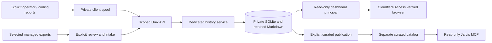

# Engineering History Foundation and Dashboard: retrospective architecture v1

Prepared November 8, 2026 under SHRR-07 / REV-52 of **Standardized History
Reporting Format and Rules**, architecture v0.4. Project: `prj_664b565ff0755dc5a14d6dc67237b2a4`.
Repository scope: `jarvis`.

## Provenance and agreement status

This is an agent-reported retrospective description based on the existing scoped
work definitions, retained records and repository documentation. It is being
saved now; it was not the original pre-implementation architecture contract.
The November 8 audit found no architecture version or governing designation in
this retrospective project grouping. **Original project-level architecture
agreement is unknown/not found in that retained project. This version is a saved
retrospective, not a newly human-approved governing design.**

The operator explicitly approved the earlier grouping of 14 existing work items
into this project and its companion project. That grouping approval does not
establish an original architecture approval. Individual earlier source or
operational approvals may exist in their original records; this document neither
invalidates them nor fabricates a missing project-wide agreement.

Existing membership, work revisions, documents, source attribution and outcomes
remain unchanged. The grouping currently has recorded state `planned`; this
document does not retroactively manufacture its lifecycle or mark work complete.
Any future implementation uses a newly agreed governing architecture and exact
work assignments rather than treating this retrospective as execution authority.

## Purpose and architectural boundary

The effort established a separately owned engineering reference archive and its
first private read-only browser. Engineering history preserves intent, known
baselines, visible explanations, documents and evidence. It remains separate from
the protected operational workflow journal that controls managed coding actions.

The diagram describes logical flow across the historical implementation slices;
the original project did not automatically capture every chat or grant Jarvis
general access to the private database. Source documents and operational rollout
receipts establish narrower facts at their own times.

## Components and data relationships

| Component | Responsibility and retained relationship |
| --- | --- |
| History contract and store | Stable work ID, immutable work revisions, rationale/criteria, scoped submissions, receipts and replay keys; known source time separate from receipt time. |
| Interactive recording client | Explicit work/session association, checkpoints and queued delivery. The original A/B/C continuity exercise used operator-designated sessions; native authenticated session identities were not established by it. |
| Managed import/review | Selected export and operational work/revision binding; imported facts retain original reported/observed limitations and are not new execution authority. |
| Immutable documents | Exact Markdown/version/digests, document-to-work binding and deterministic historical readback; no re-rendering of old bytes using today's template. |
| Scoped Unix service | Dedicated service-owned store and kernel peer identity, bounded messages, explicit private read/write policy and durable responses. |
| Dashboard | A separate read-only UID, origin JWT checks, text-only work/timeline/document/evidence views and exact document verification. No browser write/action interface. |
| Curated catalog and MCP | Deliberate selected summaries, separate publication/read boundary, generation/scope/withdrawal semantics. It is not a second authority over the full archive. |
| Protected release tooling | Hash-pinned package, protected startup/configuration, isolated host evidence and separate inactive installation/activation records. |

The dashboard reads the scoped service, not Git checkouts, raw conversations,
GitHub's current state or the protected operational database. A reported outcome,
source merge, runtime installation, browser visibility and deployment verification
remain separate evidence.

## Source and operating evidence

- `engineering/docs/engineering-history-local-foundation.md` describes the initial
  source-only contract/store slice; its historical future-work wording must not
  be treated as current live-service status.
- `engineering/docs/engineering-history-operator-runbook.md` describes installed
  explicit recording/resume, managed review and deliberate curated publication.
- `engineering/docs/engineering-history-cloudflare-dashboard.md` and
  `engineering/docs/engineering-history-dashboard-closeout.md` describe protected
  dashboard rollout and its recorded limits.
- `engineering/docs/engineering-history-managed-refresh.md` describes explicit
  refresh review; it did not enable automatic intake.
- `engineering/docs/engineering-history-curated-publication.md` describes the
  narrower Jarvis publication boundary.

These are source and historical evidence references, not a new live-host audit.
The retained foundation closeout reports a deployed milestone and identifies
remaining browser and resilience checks. Per-work outcome records preserve their
own merge/installation/source-test claims. No blanket successful acceptance is
inferred from the existence of this architecture document.

## Existing work breakdown and source baselines

These are the existing primary members. IDs and revisions are retained; no
replacement tasks or automatic reassignment are introduced. Baselines below
are the work definition's recorded Git baseline, not an inferred project-wide
start/current baseline, deployment commit or newly verified Git state.

| Existing work ID | Recorded deliverable | Work revision | Recorded Git baseline |
| --- | --- | --- | --- |
| `wrk_0a48e37a38fb4ba6b573ff52fde3b177` | Deploy private engineering-history service and begin explicit recording | 1 | `Unknown / not recorded` |
| `wrk_a4d25a13927e49068cb947f193c03cc3` | Make explicit engineering-history recording routine and validate session continuity | 1 | `726119d2146b1885e25594ed13d26a287a090645` |
| `wrk_8224cfb6222c45e481373cd8cabe9b16` | Make managed-history refreshes easier to review without automatic intake | 1 | `e0c890e80ab2fee343d36cae7501b624d16a6dfd` |
| `wrk_c4f8095d98f747e9aa0d95a4a83eda2a` | Build the first read-only engineering-history dashboard behind Cloudflare Access | 1 | `4d130a0fed23ea12d23c3b5d86bcdd88d59db25f` |
| `wrk_e33c37fac47c445da0f84a5ea2cb973d` | Add protected engineering dashboard startup and unit contract | 1 | `ed9418bbb2f396c64de00d015968444ae32af883` |
| `wrk_b6e1b179fed44cdb9ac6ac97a84aaabb` | Build isolated dashboard host acceptance package | 1 | `6557179f8ad4897a3b5473872e35af4dc633b687` |
| `wrk_4ac5d47a290c4a2d95fc7fbe9a86111f` | Prepare immutable inactive dashboard production package | 1 | `dc209c3b844d71e33aa18c76c97ec29df2fb1e03` |
| `wrk_ad1deff21fca4cdba8dab44d25361bc6` | Verify protected copy of final dashboard runtime | 1 | `8c724badfec127aff54630b303f0c0ef8f6b09e7` |
| `wrk_fc802954c1954335aefec74fdeeab8b1` | Verify live dashboard public keys and rehearse connector bridge routing | 1 | `117b77a3630b84b045736ffb1357cd8ba4f969ca` |
| `wrk_fbf4ed356b5749ca98c0cfc42bfde32e` | Prepare reviewed inactive engineering dashboard installation | 1 | `566ab6bdd6b885acb0119145f06f68c9c8fdd4ba` |
| `wrk_18d3a410d06e4a3bb8f97b6f84789eb5` | Prepare exact dashboard read-grant and origin activation review | 1 | `605415e9c115ea70c1e26f683ab2cc2d7217c683` |
| `wrk_00995461eb97484fa0f411e0cc8e511f` | Close engineering-history foundation and read-only dashboard milestone | 1 | `a71149da7cb8d6c1f14667d5db11cabcb03dd41d` |

The retrospective grouping has no selected project Git baseline in the audit.
The document does not synthesize one from the earliest or latest work commit.
Exact prior work-revision digests, assignment receipts and signed snapshot
boundaries are retained in the caller-private audit and existing history service.

## Boundaries and remaining uncertainty

- Original project-level architecture agreement is unknown; this version is
  retained retrospectively without a governing designation.
- Source records and individual outcome claims have their original provenance.
  A new retrospective does not independently verify their execution or success.
- No work membership, old document, baseline selection, lifecycle state or
  historic receipt is rewritten by retaining this document.
- The later Engineering History Workspace project and the current Standardized
  History Reporting project retain their own architectures and work membership.
- Future changes require an explicitly agreed architecture and mapped work.
  This document only reconciles the historical reference gap authorized by SHRR-07.

## Version record

| Version | Date | Meaning |
| --- | --- | --- |
| Retrospective v1 | November 8, 2026 | First retained project-level architecture description reconstructed from the existing work inventory; original agreement unknown and no governing designation asserted. |
