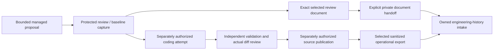

# Managed Coding Workflow Documentation: retrospective architecture v1

Prepared November 8, 2026 under SHRR-07 / REV-52 of **Standardized History
Reporting Format and Rules**, architecture v0.4. Project: `prj_d7f305b15a34578ab2c57fd87385b23a`.
Repository scope: `jarvis`.

## Provenance and agreement status

This is an agent-reported retrospective description based on the existing scoped
work definitions, retained records and repository documentation. It is being
saved now; it was not the original pre-implementation architecture contract.
The November 8 audit found no architecture version or governing designation in
this retrospective project grouping. **Original project-level architecture
agreement is unknown/not found in that retained project. This version is a saved
retrospective, not a newly human-approved governing design.**

The operator explicitly approved the earlier grouping of 14 existing work items
into this project and its companion project. That grouping approval does not
establish an original architecture approval. Individual earlier source or
operational approvals may exist in their original records; this document neither
invalidates them nor fabricates a missing project-wide agreement.

Existing membership, work revisions, documents, source attribution and outcomes
remain unchanged. The grouping currently has recorded state `planned`; this
document does not retroactively manufacture its lifecycle or mark work complete.
Any future implementation uses a newly agreed governing architecture and exact
work assignments rather than treating this retrospective as execution authority.

## Purpose and architectural boundary

The effort documented two bounded managed engineering flows: acceptance of the
installed coding workflow, and the protected review-document-to-history handoff.
Its deliverables explain custody and evidence; they do not add a new workflow
engine, authorize execution or turn imported history into approval.

This diagram summarizes the documented existing system. An arrow does not mean
that every historical task performed every step or that an automatic transition
was installed. Merge/deployment and further paid runs remain separate facts.

## Components and data relationships

| Component | Responsibility and evidence boundary |
| --- | --- |
| Bounded work definition | Exact repository, paths, baseline, validation and task identity; recorded work revision identifies the requested documentation deliverable. |
| Protected operational journal | Original submission/capture/attempt/export identities and independently observed mechanical checks; private approval detail stays outside engineering prose. |
| Managed acceptance document | Explains proposal, capture, one-use execution authorization, finish capture, validation, actual diff review, publication and sanitized history. Mechanical acceptance is not task success. |
| Historical review-document reader | Reads the exact original protected renderer/code/capture/document binding. It does not invoke today's execution admission validator or create an approval. |
| Private handoff | Retains protected source and transfers an explicitly selected bounded packet to the operator. Hash consistency is not independent human authentication. |
| Engineering history import | Binds the operational work/revision to the engineering work/revision, preserves imported provenance and exact retained Markdown, and grants no execution authority. |

## Source and retained evidence

- `engineering/docs/workflow-managed-acceptance.md` is present in the audited
  source and explains the installed workflow from the acceptance perspective.
- `engineering/docs/engineering-history-review-document-handoff.md` describes
  protected historical document custody and explicit private transfer. Its
  source/fixture/installation distinctions remain authoritative for its slice.
- The older work definition names
  `engineering/docs/workflow-review-document-history.md`; that path is absent
  from the audited source commit. This retrospective does not claim that a
  differently named document is the exact delivered artifact or that the task
  failed. Its retained work/documents and original operational evidence remain
  the references for that question.
- `wrk_c0e52ea68a4a4a2f9de4dd5670fd7a5e` retains document
  `doc_6c70373996b748a58764a28ced995e2a` and imported operational context.
- `wrk_ea6459cd88614ba8b505a880c0818270` retains imported operational events and
  document `doc_7df58a4d224148d193b1fbcc85005f64`. Imported reports do not become
  authenticated observations merely because they were retained in the archive.

Neither work has a separate `outcome.record` in the scoped audit. That absence
does not erase its imported events or establish failure. This document does not
backfill a completion report, approval or deployment result.

## Existing work breakdown and source baselines

These are the existing primary members. IDs and revisions are retained; no
replacement tasks or automatic reassignment are introduced. Baselines below
are the work definition's recorded Git baseline, not an inferred project-wide
start/current baseline, deployment commit or newly verified Git state.

| Existing work ID | Recorded deliverable | Work revision | Recorded Git baseline |
| --- | --- | --- | --- |
| `wrk_ea6459cd88614ba8b505a880c0818270` | Managed acceptance: document the installed Jarvis coding workflow | 1 | `d1068967830b2a75a371cfd3b7e81c931da6575a` |
| `wrk_c0e52ea68a4a4a2f9de4dd5670fd7a5e` | Document the protected review-to-history operator workflow | 1 | `43c95417da3998d16f0c3685415f2b35d6edaf92` |

The retrospective grouping has no selected project Git baseline in the audit.
The document does not synthesize one from the earliest or latest work commit.
Exact prior work-revision digests, assignment receipts and signed snapshot
boundaries are retained in the caller-private audit and existing history service.

## Boundaries and remaining uncertainty

- Original project-level architecture agreement is unknown; this version is
  retained retrospectively without a governing designation.
- Source records and individual outcome claims have their original provenance.
  A new retrospective does not independently verify their execution or success.
- No work membership, old document, baseline selection, lifecycle state or
  historic receipt is rewritten by retaining this document.
- The later Engineering History Workspace project and the current Standardized
  History Reporting project retain their own architectures and work membership.
- Future changes require an explicitly agreed architecture and mapped work.
  This document only reconciles the historical reference gap authorized by SHRR-07.

## Version record

| Version | Date | Meaning |
| --- | --- | --- |
| Retrospective v1 | November 8, 2026 | First retained project-level architecture description reconstructed from the existing work inventory; original agreement unknown and no governing designation asserted. |
