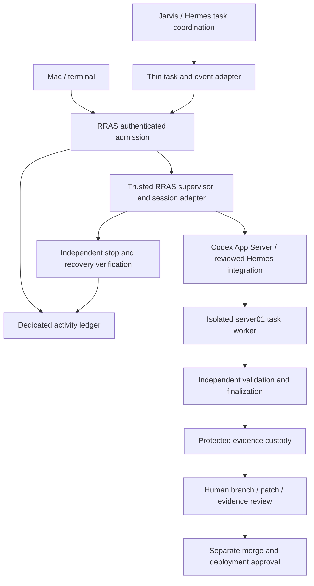

# RRAS, Hermes and Codex: target architecture and build assessment

Date: 2026-10-05. Status: **proposed target architecture; implementation and retirement gates below remain open**.

This document is the assessment and build reference for reducing duplicated orchestration while preserving RRAS engineering controls. It does not authorize installations, migrations, paid execution, privilege changes, or removal of existing safeguards. The supplied architecture-reconciliation document is proposal input, not proof of upstream safety parity.

Existing normative contracts remain authoritative until an explicitly reviewed successor changes them. See the [implementation contract](phase5b-implementation-contract.md), [executor design](phase5b-bounded-codex-executor-design.md), [threat model](phase5b-bounded-codex-executor-threat-model.md), and [controller/session design](phase5b-controller-session-integration-design.md). Historical dated sections in existing documents describe their own snapshots; this proposal does not retroactively change acceptance results.

## 1. Product outcome and scope

A human at a Mac or terminal, or Jarvis through Hermes, submits a bounded engineering task. The task is tied to a registered repository and exact baseline, executes in an isolated server01 worker with exclusive writer ownership, and produces retained changes, validation and lifecycle evidence. A human reviews the result. Merge and deployment require separate human authorization.

The same engineering identity and evidence model must eventually support human development, first-pass features, and debugging from robotics field-test evidence. Human work may have imported or attested evidence; it must not be labeled as supervised execution when it was not. Field logs, issues, repository content and tool output are untrusted inputs, never permission grants.

The first canary is one repository, one task, one attempt, one writer, a bounded validation plan and one local commit. Scheduling, autonomous retries, multi-host dispatch, remote publication, GUI and interactive handoff are later work. The conceptual upstream/custom split is a maintenance goal, not a percentage acceptance criterion.

## 2. Responsibility and authority

| Function | Native Hermes / Codex responsibility | RRAS-specific responsibility | Human responsibility |
|---|---|---|---|
| Task intake and presentation | Hermes task board, comments, dependencies and notifications; optional later Linear linkage | Canonical engineering ID; authenticated request admission; normalized immutable contract | Supply objective and review admitted authority |
| Operational coordination | Hermes claims, heartbeats, worker dispatch and task/run history, where verified for the selected release | Map operational events to exact RRAS attempt; independently reject stale, duplicate or unauthorized execution | Resolve blocked tasks and approve a new attempt |
| Coding conversation | Codex App Server threads, turns, tool events and interruption; Hermes native integration where compatible | Pin supported interface and profiles; admit session/tool authority; retain provenance and enforce bounds | Manual interaction and eventual handoff |
| Workspace | Native worktree functionality may be reused through a reviewed adapter | Registered repo, exact baseline, allocation binding, exclusive writer fencing and OS containment | Review branch and diff |
| Inspection/edit/iteration | Codex native coding tools within an admitted runtime boundary | Limit filesystem, network, processes, time and resource authority; deny escape and bypass paths | Approve broader scope separately |
| Validation | Codex can request and iterate on permitted validation | Own authoritative plan, execution receipt and independent final result verification | Assess whether evidence satisfies acceptance criteria |
| Commit and publication | Native Git tooling can assist only when explicitly admitted | First canary: trusted finalizer owns one exact-parent local commit; no remote authority | Authorize push/PR separately; control merge and deployment |
| Cancellation and recovery | Hermes/Codex may request interruption and report status | Verify exact worker termination before closure or writer release; ambiguity retains fences | Resolve ambiguous recovery with retained evidence |
| Evidence | Hermes history and Codex events supply observations | Independent custody, digests, identity bindings, validation/commit receipts and durable query references | Review and accept/reject |
| Identity and cost | Codex supports API authentication; Hermes provider behavior needs version-specific verification | Dedicated service identity, secret isolation, configurable aggregate spending enforcement | Approve budget changes and account permissions |

Hermes owns the operational queue view. RRAS owns engineering authorization, writer authority and accepted evidence. These are different state machines with a mapping, not two competing schedulers. A Hermes completion is a reported outcome; it cannot release an RRAS fence. Linear, if added, owns human backlog presentation rather than execution authority.

## 3. Target flow and runtime boundaries

The arrows show responsibility, not an already implemented transport topology. The exact placement of the Codex process and tool execution is an open compatibility gate. Native tools must execute inside the admitted worker or through a demonstrably restricted broker. Running native shell tools in the trusted host supervisor is unacceptable.

Trusted code and the approved Python runtime remain root-owned under `/opt/jarvis-codex`. The dedicated non-login `jarvis-codex-supervisor` remains distinct from personal users, Hermes UID 1000 and worker identities. Protected mutable supervisor state stays under `/var/lib/jarvis-codex/runtime-state`, supervisor-owned 0700 with protected ancestors. Preserve `/srv` ownership and all applications, credentials, configuration and retained records.

Workers receive only the assigned workspace and admitted context, bounded resources and the explicit validation interface. They receive no Docker socket, ledger credentials, claim secret, host supervisor state, sibling worktrees, personal login, publication credentials or deployment authority. The trusted supervisor's Docker access is privileged infrastructure access; it must not be exposed through generic worker commands.

The currently running Hermes deployment mounts multiple repository/task roots. Reusing that broad deployment as the coding containment boundary is not approved. A lane adapter must launch a separate restricted worker or establish equivalent tested isolation.

API credentials remain outside untrusted coding tools. If the selected native integration requires exposing a long-lived API key to a process whose tools can read it, that integration has not met the boundary. Resolve trusted inference mediation and network placement before production execution; prompts and secret-path conventions do not establish isolation.

## 4. Native capabilities: evidence and limitations

Official upstream documentation checked on 2026-10-05:

| Source | Established capability | Limit for this architecture |
|---|---|---|
| [Hermes Kanban](https://hermes-agent.nousresearch.com/docs/user-guide/features/kanban) | Durable board, task/run coordination, worktree and artifact facilities | Trusted-local-user, single-host lifecycle guards are not hostile-worker OS isolation; scratch retention differs from evidence custody |
| [Hermes worker lanes](https://hermes-agent.nousresearch.com/docs/user-guide/features/kanban-worker-lanes) | Dispatcher lane contract and pluggable spawning | External CLI lanes still require integration design; PID recovery is not exact container/cgroup termination proof |
| [Hermes Codex runtime](https://hermes-agent.nousresearch.com/docs/user-guide/features/codex-app-server-runtime) | Optional native App Server integration, coding tools, callbacks and Kanban handoffs | Documented Kanban writable roots include board state; inherited provider credentials and auxiliary calls require explicit containment/cost review |
| [Official Codex App Server](https://learn.chatgpt.com/docs/app-server) | Thread/turn protocol, events, interruption and API-key authentication | Protocol completion/interruption does not prove worker death, evidence acceptance or writer release |

These are documentation findings, not installed acceptance. The installed Hermes image was observed as `sha256:b99f4564d5e17ec0183314c0d2f6f633657cff4916fad0f05f6e7667722da432`. Its corresponding source revision, enabled features and compatibility with a selected Codex release still need verification. No current client/model pin is approved by this proposal. Earlier proposed pins in Phase 5B notes must be assessed against an exact release, protocol schema and artifact hashes before reuse.

Prefer reuse of native session and coordination code. Do not build another general conversation engine, board, plugin ecosystem or GUI. Retain a narrow RRAS adapter where upstream assumptions differ from RRAS authority. Never treat documentation on moving upstream `main` as a production version pin.

## 5. Common task, authority and evidence contracts

Extend existing versioned contracts rather than inventing a parallel task envelope. Minimum binding:

| Binding | Required semantics |
|---|---|
| Engineering/task identity | Stable RRAS task key; external backlog/board IDs are namespaced references |
| Execution identity | Exact request, claim, run, attempt and authenticated controller; one admitted attempt initially |
| Repository authority | Registered repository ID, canonical repository, baseline commit, task branch and allocation/worktree IDs |
| Upstream identity | Pinned Hermes release, board/task/run IDs and Codex thread/turn IDs mapped to the RRAS attempt |
| Policy | Contract/profile/validation digests; allowed context, tools, resources, deadline, output and spending policy |
| Outcome | Proposed worker result separately from independently verified execution/validation/commit outcome |
| Custody | Artifact manifest, digests, receipt locations, producer identity, sequence and acceptance/rejection reason |

Adapters accept request IDs and authenticated operations; callers cannot override host paths, worker identity, owner tokens, model profile or policy. Create, execute, edit, validate, commit, push, PR, merge and deploy are distinct capabilities. Task prose, a board status or a plugin's availability grants none of them.

The existing structured-edit/scripted executor cannot simply accept a native session in place of `ModelTransport.invoke()`. Native tools edit and execute directly. A reviewed successor session profile must specify iterative validation authority, tool/process boundaries, event limits and finalizer ownership while retaining existing identity, stop and custody guarantees. Version that adaptation; do not silently broaden v1/v2 semantics.

Persist adapter events idempotently using stable source IDs and exact attempt bindings. Retain raw bounded events as observations and normalized acceptance receipts separately. Duplicate or out-of-order events cannot launch another worker, re-run validation, issue another commit or release authority. Reconcile durable state after a lost acknowledgement; uncertain ownership blocks progress. No distributed transaction between Hermes SQLite, the activity ledger and Docker is assumed.

## 6. Lifecycle, recovery and review

The target RRAS lifecycle is admission → allocation/claim → bounded execution → independent verification → evidence custody → human review. Existing implementation state names and closure/release ordering remain authoritative until a reviewed mapping is implemented. Evidence retention and human review survive task execution closure.

An adapter maps Hermes ready/running/review/done/blocked observations onto RRAS state without treating names as equivalent. In particular, done cannot mean merged or deployed. Expired heartbeat, exited parent, interrupted turn and missing acknowledgement each require exact authority/worker checks before terminal reconciliation.

Cancellation persists an authenticated intent, requests stop, verifies the exact worker is stopped/removed, retains proof, and only then allows lifecycle closure and ordered writer release. Failure to prove termination leaves the request blocked or recovery-pending with both fences retained. Native restart/reclaim must never automatically create a second attempt while RRAS ownership remains unresolved.

Review package: baseline and final commit IDs, branch, patch/diff digest, contract and instruction provenance, validation argv/results/logs, model/client provenance, cost receipts, containment and cancellation receipts where applicable, custody manifest, and explicit limitations. A model's summary is supplementary. Human rejection retains evidence; a retry is a separately admitted attempt.

## 7. Authentication, spending and database

Personal Mac/SSH Codex login remains the manual development entry point. It is not unattended executor authentication. Automated sessions use the approved dedicated API Platform service identity. No credential is read, moved or provisioned by this architecture document.

Defaults remain configurable: **USD 5 per task, USD 20 per day and USD 100 per month**. Store a versioned policy, record its effective values on admission, and define timezone/window boundaries explicitly before activation. Reserve cost atomically across concurrent tasks; include all retries, auxiliary calls and child model calls attributable to a task. Fail closed on unavailable accounting, unknown prices or exhausted authority. Reconcile actual usage without treating timeout as zero cost. A provider/dashboard alert is not proof of an enforced ceiling. Any in-flight overshoot must be bounded by the admitted worst-case request and included in reservations; post-call token accounting alone cannot guarantee the ceilings.

Use only the dedicated activity-ledger deployment, not engineering-postgres or disposable validation. Read-only inspection on 2026-10-04 proposed host `172.23.0.2`, port `5432`, database `jarvis_activity`, role `jarvis_activity_app`, reached through its internal bridge without a published port. This is a dated endpoint observation, not a permanent address or successful host-role authentication. See [deployment evidence](phase5b-controller-host-deployment-evidence.json).

The source recovery service pins endpoint identity and verifies schema/grants. Two required relations were absent: `activity.phase5b_execution_bindings` and `activity.phase5b_execution_writer_leases`. Review the target mapping and minimal schema before deciding whether the existing migration is still the right change. Do not use an administrator/migrator identity for controller operations or expand app privileges to bypass this gate. Production migration, credential provisioning, installation and activation require separate reviewed procedures.

## 8. Current checkpoint and component disposition

Repository checkpoint: branch `phase5b/guarded-host-orchestration`, HEAD `f0d8a6eaf016153708c3e46a32e204a93bd11a97`, with substantial existing uncommitted work. Preserve it. See [service preparation](phase5b-controller-service-preparation.md), [integration review](phase5b-controller-evidence-integration-review.md), [remaining work](phase5b-remaining-work.md) and [operator guide](phase5b-operator-unblock-guide.md).

Reported source verification on 2026-10-04: 753 tests, zero failures/errors, three skips. Installed stop-only acceptance passed eight cases in `77adfb3881004b57bdc8192cdb251f93`. Disposable PostgreSQL/HTTP cancellation passed five cases each in fake-worker `3e7bb51e77f64df6aeb4d9b4395aa12e` and real-worker `3d0c2d41cbd74748bbec81d6cf8fa086`. These are snapshot-specific results, not installed production controller/session acceptance. There is no production Codex transport or paid canary. Reconcile-v1 remains installed; the recovery-service candidate is uninstalled; keep the timer disabled.

| Existing component | Proposed disposition | Retirement condition |
|---|---|---|
| `contracts/`, admission and repository registry | KEEP, version narrowly | No retirement proposed; upstream task fields cannot replace authority |
| `controller/phase5b_controller.py`, durable leases/cancellation | KEEP safety authority; THIN operational coordination after parity | Native adapter preserves exact stop/closure/release and replay behavior |
| `src/activity_ledger/worktree_allocator.py` and persistence | KEEP; investigate native allocation adapter | Exact baseline/ownership/no-follow checks and competing-writer acceptance remain enforced |
| `host/phase5b/guarded_executor.py`, supervisor/watchdog/reconciliation | KEEP safety boundary | Replacement passes actual host/cgroup/container failure acceptance |
| `host/phase5b/controller_worker_adapter.py` | THIN-ADAPTER to native runtime | New versioned tool/session boundary accepted without host bypass |
| `executor/phase5b_session_broker.py` and scripted transports | INVESTIGATE; retain deterministic fixtures; replace production-facing simulation | Real interface passes policy, accounting and recovery gates; preserve test oracles |
| `src/activity_ledger/phase5b_evidence.py` and custody | KEEP | No retirement proposed; native history supplies inputs, not independent custody |
| Recovery-only service candidate | INVESTIGATE before further installation | Decide which process owns recovery under selected Hermes integration; retain proven semantics |
| Custom generic scheduling/session/UI ideas | REPLACE-UPSTREAM where parity is established | Pinned integration, migration plan and rollback validated |
| Acceptance harnesses and historical evidence | KEEP | Never remove evidence merely because its implementation is superseded |

No source component is approved for removal now. Mark deprecation only after replacement acceptance; remove later in a separate review. Keep retained records readable across upgrades. The current split is a proposal, not a declaration that source is redundant.

## 9. Ordered build and validation gates

Every slice retains a machine-readable manifest: repository/source baseline, upstream pins, policy hashes, test cases/results/skips, fixture ownership, cleanup outcome, residual fences and unresolved limitations. Source tests cannot substitute for installed acceptance.

| Slice | Deliverable and concrete acceptance | Host validation and progression gate |
|---|---|---|
| A — Exact inventory and compatibility assessment | Resolve installed Hermes source revision and candidate Hermes/Codex pins; inspect exact dispatch/auth/tool code; create capability-to-test matrix; record absent features and proposed contract delta | Read-only deployment/source inspection; no credentials or settings changed. Decide feasible worker/session topology before implementation |
| B — Credential-free task/event bridge | One fake task maps request/attempt, Hermes run, thread/turn and allocation; duplicates/out-of-order events are idempotent; stale completion cannot close/release; no auto-retry; raw and normalized evidence retained | Disposable model-free server01 integration using own resources. Keep installed service unchanged; demonstrate unrelated applications survive |
| C — Native session containment proof | Real pinned client with fake inference/protocol fixtures inspects/edits/iterates only admitted workspace; broker/native-tool bypass denied; controller finalization remains authoritative | Disposable worker checks for sibling/state/secret/DB/socket denial, network/resource limits, process descendants and escaped commands. If fake inference cannot exercise a boundary, report the gap; never call it proved |
| D — Lifecycle and cancellation parity | Crash, stale claim, lost acknowledgement, competing writer, ambiguous identity and Docker denial preserve safety; exact stop precedes close/release | Actual disposable systemd acceptance of proposed topology, including controller/watchdog cgroup death, restart and unrelated-container survival. Operator procedure includes bounded ownership, journal and exact cleanup/rollback |
| E — Ledger and disabled release preparation | Minimal reviewed schema/event bindings; app-role grants; endpoint pin; immutable release/runtime; credential sources; partial-install recovery; replay across adapter restart | Disposable PostgreSQL acceptance and disabled installed-service acceptance. Production migration/provisioning/install remain separate authorized operations |
| F — Live budget and canary readiness | Atomic reservations enforce all three limits including auxiliary calls; unknown usage denies further calls; pin model/pricing/runtime; retain billing receipts | Model-free concurrent/exhaustion/crash tests, then separately authorized one-task paid canary with branch/patch/validation/custody and residue audit; no remote writes |
| G — Human workflow and cleanup | Terminal and Hermes intake converge; human acceptance/rejection recorded; native operational view reflects RRAS outcomes; component parity matrix complete | Operator review end to end. Deprecate duplicated code only with passing replacement evidence and restore procedure; remove in a later reviewed change |
| H — Product expansion | GUI, interactive handoff, Linear/PR links, richer robotics evidence and optional scheduling | Separate authorization/credential gates; maintain stopped-worker proof and budget authority through handoff/retry |

**Smallest next implementation slice:** B's bridge contract and deterministic event reducer, after A establishes an exact compatible upstream seam. It resolves identity/state overlap without using credentials or weakening existing fencing. Do not start by rewriting the ledger, installing the recovery candidate, or deleting the custom controller. A is the immediate read-only prerequisite, not permission for an upstream upgrade.

## 10. Decisions and completion criteria

Already selected: API Platform identity, configurable spending defaults, dedicated supervisor, protected `/opt` code and `/var/lib` state, verified-stop cancellation, and human-controlled merge/deployment.

Decisions still requiring a concrete proposal and review:

1. Exact Hermes/Codex/model pins and placement: native Hermes runtime in a restricted worker versus a thin external lane/session adapter. Select only after API identity, tool containment and credential separation are demonstrated.
2. Contract adaptation: admitted iterative tools/validation and event semantics; preserve trusted final commit initially. Decide whether the chosen native interface can enforce that split.
3. Budget windows/timezone, price versioning, reservation ceilings and policy-change behavior for already admitted tasks.
4. Minimum ledger/schema change and service topology after bridge assessment; migration, installation, credentials and activation remain pending.

The first product is complete when a manually admitted and a Hermes-admitted task follow compatible contracts, each produce reviewable isolated changes and independently verified evidence, and cancellation/restart cannot create an unauthorized second writer. The paid canary must satisfy the configured cost policy. Human review must remain the only route to merge/deployment. No task history, test count, successful model turn or local commit alone satisfies these conditions.

For cleanup, require a before/after component inventory, each retired function's replacement and acceptance receipt, backward-readable evidence, exact rollback instructions and confirmation that no installed service, secret or retained fence was implicitly changed. This document supplies the assessment gates; it is not an executable administrator procedure.
