# RRAS native-first architecture: minimum internal engineering system

Date: 2026-10-05. Status: **review proposal; no deployment or cleanup performed**.

**Approved policy adjustment, 2026-10-05:** the operator approved this native-first direction and deferred custom hard-budget enforcement until the core system is functional. Current cost controls are operator-managed API portal settings. The hard-budget prerequisites and gateway estimates below are historical future work, not current deployment blockers. $5/task and $20/day remain future configurable goals; they are not enforced by this implementation. See the [step-two checkpoint](rras-native-step2-implementation.md) for current scope and portal behavior.

This re-evaluates the [earlier target architecture](rras-hermes-codex-target-architecture.md) under a native-first principle. Its proposed component dispositions replace that document's default retention recommendations if approved. Existing services, records, secrets and fences remain untouched. It does not retroactively change Phase 5B acceptance evidence or authorize deleting source or changing installed services.

## 1. Recommendation

Use **Hermes Kanban as the only operational task system**, Hermes worktrees and worker lifecycle as the execution infrastructure, and Codex App Server with its native sandbox and tools as the coding runtime. RRAS adds a small engineering record/admission utility and an evidence index. The operator controls irreversible actions. Do not build a second controller, scheduler, lease protocol, tool broker, worktree allocator or cancellation state machine merely to improve an unmeasured worst case.

The minimum system serves one trusted operator on server01, processing one coding task at a time in registered internal repositories. Model mistakes and prompt injection are credible; a malicious administrator, hostile multi-tenant code execution and distributed scheduling are outside this initial assurance target. It offers practical workspace protection and recoverable changes, not proof of adversarial isolation or exactly-once execution.

**Native defaults are acceptable unless a specific RRAS requirement fails in observation or a focused test.** Version discovery and configuration checks are integration work, not a requirement to re-certify every upstream safety mechanism. A missing integration setting calls for a configuration fix first, a small adapter second, and new infrastructure last.

## 2. Smallest topology

```mermaid
flowchart LR
    Intake[Operator terminal or Jarvis] --> Records[RRAS admission and task record]
    Records --> Board[Hermes Kanban]
    Board --> Native[Hermes worktree and worker lifecycle]
    Native --> Codex[Codex App Server and sandbox]
    Codex --> Local[Edits, tests and local commits]
    Local --> Export[RRAS evidence export and index]
    Export --> Review[Operator review]
    Review --> Actions[Operator push, merge and deployment]
```

There is one upstream dispatch authority and one RRAS engineering identity. RRAS reads operational state but does not control Hermes claims or run closure. Export can be an explicit CLI action at review time; reliable event streaming is not a first-canary dependency. A missed export leaves the task unreviewed, with a repairable index gap, rather than stopping or restarting the worker.

**Processes to add:** initially no RRAS daemon. One small CLI/package handles admission, export and review records. Reuse existing database access where suitable; retain a local export manifest when indexing is unavailable. Do not add an always-running RRAS event bus or recovery service. A spending gateway is an exception only if needed to meet the selected hard ceilings; see section 6.

## 3. Clear ownership

| Function | Owner today | RRAS scope / accepted limitation |
|---|---|---|
| Board, dependencies, claim, heartbeat, retry and crash recovery | Hermes | Record upstream IDs and outcomes; no parallel RRAS state machine |
| Worktree creation and branch management | Hermes | Admit registered repository and baseline; inspect actual worktree/branch before review |
| Shell, edits, testing and local commits | Codex native tools | Task acceptance criteria, profile choice and evidence capture; no trusted host finalizer |
| Workspace protection and tool approval | Codex sandbox / native policy | Configure and inspect effective roots/permissions; fix concrete access failures |
| Cancellation and process lifecycle | Hermes / Codex | Record outcome; operator resolves uncertain leftovers before rerunning the same task |
| Engineering identity and traceability | RRAS | Stable task ID, repo/baseline and upstream task/run/session references |
| Evidence retention and indexing | Hermes artifacts/history plus RRAS export | Copy review essentials and digests; distinguish reported, reproduced and human-attested evidence |
| Push, PR, merge, deployment and production migration | Operator | No such credentials or tools in automated coding profile; optional future approved action service |
| Spending | Native controls if they satisfy hard limits; otherwise narrow budget gate | Preserve $5/task, $20/day, $100/month; do not describe advisory limits as enforcement |

Manual Mac/SSH Codex development remains usable with the operator's personal login. Its work is imported/attested into RRAS when needed. Automated Hermes coding uses the selected API Platform service identity, never that personal login.

## 4. Native evidence, not a theoretical parity barrier

Documentation reviewed on 2026-10-05 establishes the following; deployed settings and exact release still need ordinary integration verification:

- [Hermes Kanban](https://hermes-agent.nousresearch.com/docs/user-guide/features/kanban) provides task coordination, worktrees, retained artifacts and lifecycle history. Its trusted-local-user assumption fits this initial environment. Choose preserved worktrees rather than ephemeral scratch workspaces for coding.
- [Hermes worker lanes](https://hermes-agent.nousresearch.com/docs/user-guide/features/kanban-worker-lanes) supplies the worker handoff/claim contract. An external runner is still integration work; prefer the existing Hermes worker runtime rather than constructing another lane by default.
- [Hermes Codex runtime](https://hermes-agent.nousresearch.com/docs/user-guide/features/codex-app-server-runtime) supplies native tool and session integration, including named custom providers. Review inherited credentials, auxiliary model calls and callback tools in the chosen profile; do not recreate the conversation engine.
- [Official Codex App Server](https://learn.chatgpt.com/docs/app-server) documents sandbox policies, restricted read roots, approval controls and API authentication. Use those controls directly before considering custom syscall or tool mediation.

The earlier inspected Hermes image ID is `sha256:b99f4564d5e17ec0183314c0d2f6f633657cff4916fad0f05f6e7667722da432`; its matching source revision has not been established. Select exact Hermes/Codex versions during integration. Historical proposed model/client pins are not automatically adopted. No undocumented setting is assumed to exist.

## 5. Practical risk versus retained custom cost

There is no measured RRAS incident frequency from which to calculate probabilities or annual losses. The numbers below are **planning judgments**, not observed percentages. Impact I: 1 = minor inconvenience, 2 = task rework, 3 = meaningful engineering loss, 4 = sensitive data/production consequence, 5 = safety-critical consequence. Exposure E: 1 = unusual under current workflow, 2 = plausible edge case, 3 = recurring opportunity, 4 = frequent opportunity, 5 = unavoidable. Score = I × E; this ordinal score supports prioritization, not actuarial comparison. Scores describe the single-operator native baseline, including human review, retained worktrees and withheld irreversible-action credentials.

Effort ranges are estimates in engineer-days; maintenance is estimated engineer-hours per month after stabilization. They include focused tests, not elapsed deployment time. Validate estimates after the first implementation slice. Reusing suitable existing functions can lower effort; carrying their entire service dependencies can raise it.

| Retained RRAS function | Concrete failure reduced | Baseline → proposed residual score | Incremental implementation / maintenance | Why worth retaining |
|---|---|---|---|---|
| Stable ID and upstream reference mapping | A fix/test result cannot be traced to the robotics issue or task | I3 E4=12 → I3 E1=3 | 1–2 days / 0.5–1 h per month | RRAS-specific linkage is absent from generic upstream task identity; small record, no orchestration |
| Repository admission and baseline capture | Work starts against the wrong repository or revision | I3 E3=9 → I3 E1=3 | 1–2 days / 0.5–1 h per month | Small allowlist/preflight; captures actual commit. No custom allocator required |
| Review evidence export/index | Workspace/history changes or a missing log prevent later diagnosis | I3 E3=9 → I3 E1=3 | 2–3 days / 1–2 h per month | Copy patch, test logs and provenance at review; no independent live execution controller |
| Operator decision receipt | Accepted/published work lacks a recorded reviewer and exact commit | I3 E2=6 → I3 E1=3 | 0.5–1 day / <0.5 h per month | A record/CLI step suffices; do not build approval infrastructure yet |
| Hard-budget gap fix, only if native configuration fails | Automated/auxiliary calls exceed selected dollar ceilings | I2 E3=6 → I2 E1=2 **conditional on enforced reservations** | 4–8 days / 1–3 h per month if a gateway is required | Explicit user requirement. Existing simulated accounting is insufficient; this may dominate custom cost |

The first four functions form **one utility**, estimated 4–8 engineer-days combined and 2–4 h/month, with a target of 300–700 new production lines plus focused tests. This is a scope budget, not a guarantee or a reason to compress clear code. The budget gateway is separately costed; avoid it if native enforcement actually meets the requirement. Irreversible-action credential exclusion is deployment configuration and operator practice, not another custom service: approximately 0.5–1 day initial review and <0.5 h/month.

The scores do not claim hash manifests make evidence tamper-proof or admission defeats a malicious local user. Same-user alteration remains possible. Meaningful remaining risks are visible and recoverable before publication.

### Custom infrastructure not justified today

| Phase 5B mechanism | Practical incremental benefit beyond the native baseline | Cost proxy / estimated ongoing burden | Decision |
|---|---|---|---|
| Independent controller/DB claims/local writer fences | Reduces rare split authority or stale-worker overlap; estimated I2 E2=4 → I2 E1=2 with serial reviewed work | Controller + admission: 671 lines; 2–4 h/month across authority/schema/integration tests | Do not use in new path. Native claims + one active coding task + operator checks suffice |
| Custom worktree allocator | Adds race-resistant/path-identity assurance beyond native allocation | 422 lines plus persistence/fixtures; 1–2 h/month | Replace with native worktrees and small repo/baseline preflight |
| Guarded Docker worker adapter and watchdog stack | Independent death proof and tighter bounds; stale descendants mainly threaten disposable task state in this scope, I2 E2=4 → I2 E1=2 | Guarded executor + adapter + supervisor + watchdog: 1,246 lines; 3–6 h/month, host/version regressions | Keep off new execution path; accept native lifecycle/sandbox unless a real requirement fails |
| Custom session/tool broker and trusted finalizer | Prevents native tools bypassing a narrowly defined edit protocol; little additional value when native coding is intended | Scripted session broker: 346 lines, further production transport unfinished; 2–4 h/month if extended | Retire production direction; keep useful deterministic fixtures; native tools/local commits acceptable |
| Separate recovery service and credential/installation machinery | Offers unattended exact-proof recovery, unnecessary for a single operator handling rare failures | Service module: 219 lines plus bootstrap/units/install procedures; 1–3 h/month | Do not install candidate; use native recovery and a short operator runbook |
| Broad installed-systemd parity harnesses | Certify stronger prior architecture, rather than minimum native workflow | Two acceptance harnesses: 1,238 lines; substantial manual host iteration | Preserve history; replace first-canary gate with small requirement-based native checks |

Line counts are measured source size on this worktree, not removed lines, defect counts or independent complexity measures. The above estimates overlap; do not sum them as measured savings. `pg_adapter.py` is 1,921 lines serving broader ledger functions; it is **not** a deletion target just because custom execution is retired. Existing engineering contracts/evidence helpers may be reused as libraries without retaining their controller dependencies.

No real-world probability reduction has been proved for the stronger mechanisms. Their passing tests prove behavior within those tests; they do not prove the incremental controls are necessary for this operating model. Sunk implementation effort is not a retention argument.

## 6. Minimum operating policy and the genuine spending gap

Initial profile: trusted internal repositories only; one active coding task across the engineering profile; native preserved worktrees; local edits/tests/commits allowed; no unattended retries or scheduler initially; no push/PR/merge/deploy. Set native iteration/time limits where supported. If a global concurrency setting is absent, keep only one ready coding task operationally rather than build a new lock service. Manual development must not edit the active automated worktree.

Use workspace-write sandboxing with task roots and the upstream-required Kanban paths only. Restricted reads should exclude unrelated secrets where supported. Disable worker tool networking initially. Disable unneeded MCP/plugin callbacks, especially production/cloud actions. A sandbox limits the tools, not necessarily trusted runtime callbacks: examine the effective callback list and test the specific destructive paths. Do not grant sandbox escalation automatically to make a failing task pass.

The currently deployed Hermes process has access to several repository/task roots. This alone is not a requirement to build a custom container stack. Configure the engineering profile's native roots and check that a test cannot edit a sibling. Inspect its actual authority: if it carries Docker socket/root/sudo or production write access, withhold that authority from the coding profile. Use ordinary OS identity/access configuration if needed, rather than Phase 5B orchestration. Do not modify the current deployment during this review.

Automated auth remains a dedicated API Platform credential. Native inherited-credential behavior is accepted as an ordinary local service model when the engineering identity has no production authority, the credential is narrowly scoped, and cost is enforced. The earlier requirement to hide every inference credential behind bespoke mediation is not retained solely for theoretical strength. Tool access to unrelated credentials or publication authority is a concrete failure. If exposure of even the scoped inference credential becomes unacceptable, add a proxy at that upgrade point.

**$5/task, $20/day and $100/month are hard selected ceilings, not optional targets.** Proposed policy fields are `task_limit_usd`, `daily_limit_usd`, `monthly_limit_usd` and `budget_timezone`; USD integer cents internally. Recommend America/New_York calendar days/months, effective policy version retained per task. This is a proposal, not an applied setting.

No inspected native feature proves these three aggregate ceilings are enforced. Iteration limits, post-call usage totals and dashboard alerts cannot guarantee them. The current RRAS ledger is simulated. Before live tasks, check available native/provider controls against a small exhaustion test. If insufficient, implement a narrow compatible inference budget gateway with pre-call worst-case reservation, all model/auxiliary traffic routed through it, bounded billable inputs/outputs, timeout reconciliation and no direct-key bypass. Do not carry the scripted tool broker/controller into the solution.

If the selected native API route cannot support a conservative per-call bound or task attribution, strict ceilings are **blocked**, not silently approximate. Credential-free setup and model-free tests can proceed. A live canary must wait for enforcement or a separately explicit operator change to the ceiling requirement. This is a real requirement conflict, not an invitation to build theoretical containment.

## 7. Minimal RRAS record and evidence model

Keep one stable task record: RRAS task ID, objective/criteria, registered repo ID and canonical path, initial commit, approved profile, Hermes board/task/run references, available Codex thread/turn IDs, artifact manifest, review status, reviewed commit and operator decisions. Sessions can be referenced as unavailable with a reason; do not invent IDs from missing native events. No RRAS claim secret, writer-lease table, allocation generation or parallel lifecycle authority is needed in this target.

Evidence states: `reported` (worker transcript/log), `captured` (exported bytes/digests), `reproduced` (operator independently ran the check), and `reviewed` (operator accepted exact content). Preserve actual validation command, return code and output; testing evidence is not a proof of correctness. Native commits need no trusted finalizer: review exact baseline-to-head diff, uncommitted changes and unexpected ancestry before accepting. Native task completion means execution reported complete; it never means RRAS review, merge or deployment occurred.

Capture patch, tracked/untracked status, base/head commits, relevant logs, native task/run references and profile/version metadata. Export on explicit review initially. Missing essential evidence marks the record incomplete; regenerate from preserved worktree/history or rerun the check with a receipt. Deduplicate by source ID or task/run/manifest digest. If an upstream event is missed, reconcile by reading task history; do not rebuild a transactional event bus.

Use the dedicated `jarvis_activity` deployment and the approved `jarvis_activity_app` role for indexing only where existing grants/schema permit. Earlier read-only inspection found no host-published DB port; bridge reachability was observed, app TCP authentication remains unverified. See [deployment evidence](phase5b-controller-host-deployment-evidence.json). An unavailable database does not erase local exports or restart a task. Queue explicit indexing later; no broad grant expansion or production migration is implied.

The missing Phase 5B binding/writer-lease relations are no longer automatic blockers for this architecture because it does not use those authorities. Inspect whether current task/run/artifact records can carry the minimal references before proposing any new table. Keep engineering-postgres and disposable DBs separate.

## 8. Cancellation, recovery and accepted risk

Use native cancellation and worker recovery. On uncertain interruption, the operator checks the native task/process state, inspects the affected worktree, and resolves leftovers before rerunning that task or starting conflicting work. Preserve changes and logs. A native status can precede complete descendant exit; accept that limited risk initially, rather than require a custom verified-stop lease-release protocol.

No stronger stop-before-RRAS-closure rule is needed because this design has no independent RRAS writer lease to release. Existing Phase 5B writer fences are different: **never clear or reinterpret them as part of this transition**. Their old attempts require the existing procedure. This proposal relaxes future architecture requirements; it does not alter the meaning of retained records.

Accepted risks: a worker can falsify its own summary; same-user software may alter native history; a leftover process can affect a task workspace; sandbox/read defaults can reveal data unless configured; local commits can be wrong. Review, exported evidence, restricted irreversible authority and recoverable worktrees reduce practical consequences. None of those risks justifies claim/lease duplication by itself.

Not accepted: unattended production action, writes to an unrelated admitted test workspace, personal-login reuse for automation, missing indispensable review evidence, or paid execution without agreed cost enforcement. These are concrete tests/gates, not demands for hostile multi-tenant containment.

## 9. Small validation set and implementation sequence

| Step | Work | Acceptance / evidence |
|---|---|---|
| 1 — Native profile assessment | Record deployed/candidate Hermes and Codex versions; configure or propose engineering profile, API provider, roots and callbacks | Read-only inventory first; record settings needed. No full Phase 5B parity requirement |
| 2 — Minimal admission/export CLI | Reuse suitable ID/repo/evidence functions; submit through native intake; export local review package | Wrong repo rejected; actual baseline captured; repeat submission maps same task rather than duplicates; duplicate export harmless; unavailable index retains package |
| 3 — Native model-free acceptance | Use ordinary native worktree/task interfaces and deterministic fixtures where available | Worktree/branch retained; sibling write denied; prohibited callback has no authority; cancel/restart leaves understandable state; unrelated application unaffected. Record untested model-dependent behavior honestly |
| 4 — Spending requirement | Native controls exhaustion test or narrow budget gateway | Per-task/day/month exhaustion and auxiliary-call attribution; lost reply not charged zero; no bypass route; record remaining limitation if exact bounds unavailable |
| 5 — Single paid canary | Separately authorized small feature/test task, native iteration and local commit | Operator reviews exact patch and validation, exports/indexes receipt, verifies cost; no remote write or production action |
| 6 — Retire duplicate path | Inventory production references, preserve old evidence, mark unused custom execution path historical | New path meets minimum checks, not every old stronger invariant; separate reviewed cleanup/installed-service procedure; rollback returns to known setup without adopting old fences |

Run relevant small tests, not the entire legacy suite for each documentation or adapter change. Retain historical test suites as reference; do not force the new native workflow to satisfy obsolete structured-edit/finalizer/independent-lease assumptions. Add tests for each retained RRAS function and each observed regression. No manual host acceptance or model-backed task has run for this proposal.

**Immediate next slice:** read-only native profile/version assessment plus the minimal admission/export record definition. Then build that CLI, not the previously proposed live event reducer or production recovery service. Cost enforcement is investigated in parallel conceptually and remains a live-use gate.

## 10. Cleanup and upgrades driven by evidence

Preserve the earlier [service checkpoint](phase5b-controller-service-preparation.md), [acceptance history](phase5b-controller-evidence-integration-review.md) and [operator guide](phase5b-operator-unblock-guide.md). Current branch is `phase5b/guarded-host-orchestration`, HEAD `f0d8a6eaf016153708c3e46a32e204a93bd11a97`; existing uncommitted work and installed reconcile-v1 remain intact. The timer stays disabled. Do not install the custom recovery-service candidate or execute its binding/lease migration just to complete an obsolete plan.

Retirement needs proof the old path is unused, readable archived records, reviewed removal scope and a rollback procedure. It does **not** need proof the native path enforces every stronger Phase 5B invariant. Do not delete shared ledger helpers, whole adapters or successful journals by directory name. Installed-service retirement is a later administrator operation, separate from source cleanup.

| Evidence/change in operating model | Stronger control to consider | Trigger for reassessment |
|---|---|---|
| Native sibling-write or secret-read denial fails | Correct native roots/access first; dedicated OS identity or container if native policy cannot meet the requirement | One reproducible failure of the required boundary |
| Stale descendant damages a task or concurrent runs collide | Native lifecycle fix, then process-group/systemd scope; custom fence only if actual native fix is insufficient | One reproducible harmful overlap; multiple simultaneous writers introduced |
| Second operator or independently dispatched writers | Stronger repo admission, authenticated shared ingress and writer arbitration if upstream coordination fails | Concurrency/identity assumptions change |
| Untrusted repositories or external tenants | Dedicated workers, secret proxy, stronger filesystem/process containment | Before admitting such work, not after an incident |
| Evidence cannot be reconstructed or disappears | Automated exports and separate custody identity/storage | One essential lost review package or repeated repair burden |
| Automated push/PR/deploy is requested | Narrow approved-action service with exact-commit approval receipts and scoped credentials | Before granting irreversible remote authority |
| Multi-host, unattended recovery or availability requirement | Distributed coordination/independent recovery where native infrastructure demonstrably lacks it | Explicit product requirement, not theoretical scalability |

Review the first 20 completed tasks or first month, whichever comes first: count wrong-repo admissions, duplicate launches, conflicting writers, cancellation leftovers needing intervention, missing evidence, budget blocks and minutes spent repairing each. These are future measurements, not current data. Add a control only against a documented failure/requirement, with expected intervention time or impact saved exceeding implementation and maintenance burden. A control removed as unnecessary today remains available as a later upgrade.

## 11. Review decisions

Approve or amend this target responsibility split and its explicit risk acceptance. Existing API identity and dollar ceilings stay selected. Confirm whether America/New_York calendar budget windows are suitable. Concrete version pins, native engineering profile settings, migration needs and any budget-gateway design will be proposed after the small assessment; no credentials or default privileges will be invented.

If approved, the working product is native Hermes/Codex plus a small RRAS traceability utility and operator gates. Production coding remains pending the actual native integration and hard-budget checks. This proposal reduces custom orchestration substantially without pretending every remaining requirement is already implemented.
